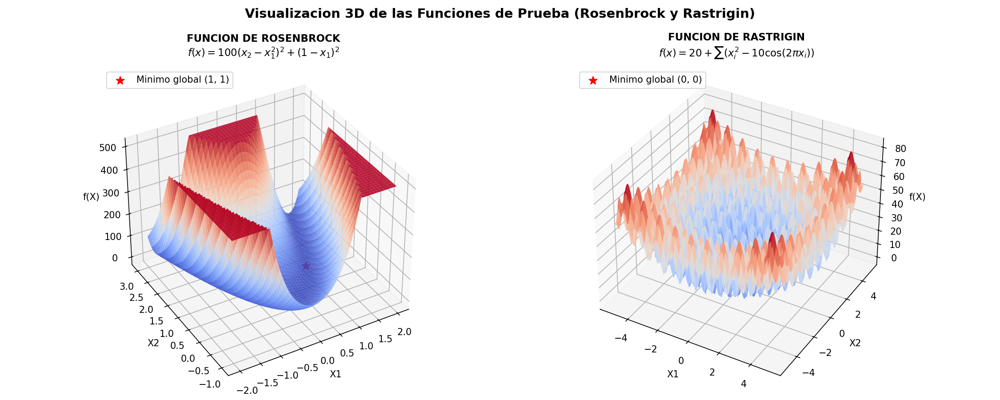
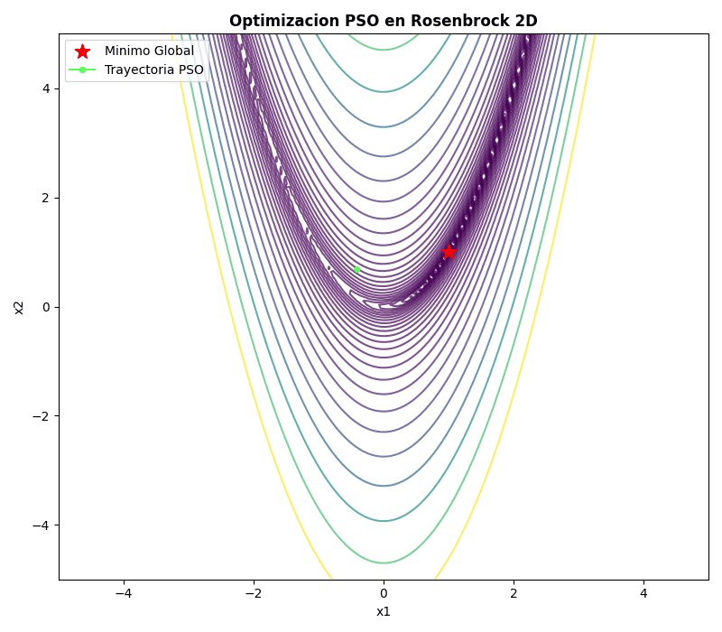
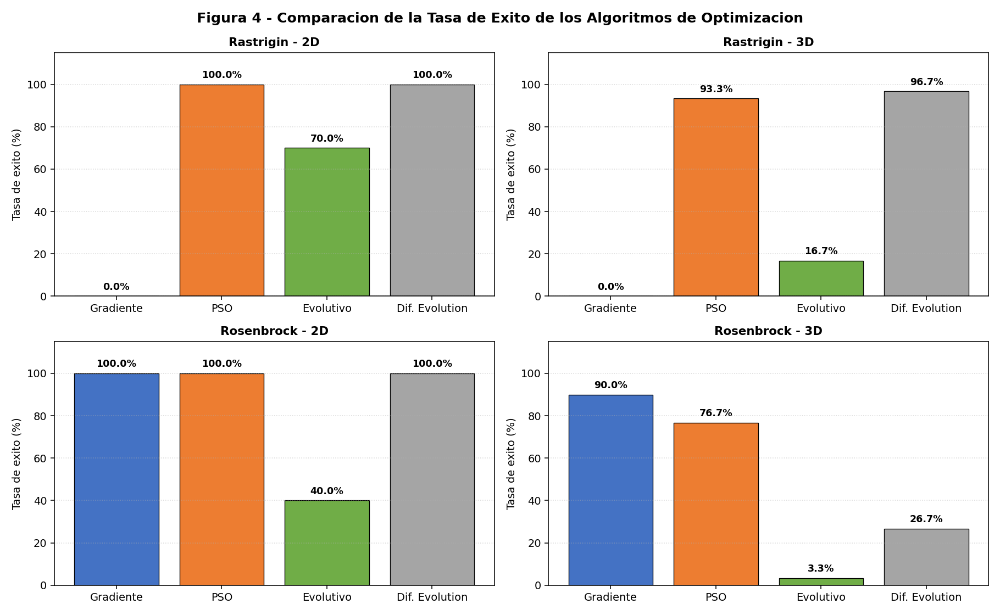
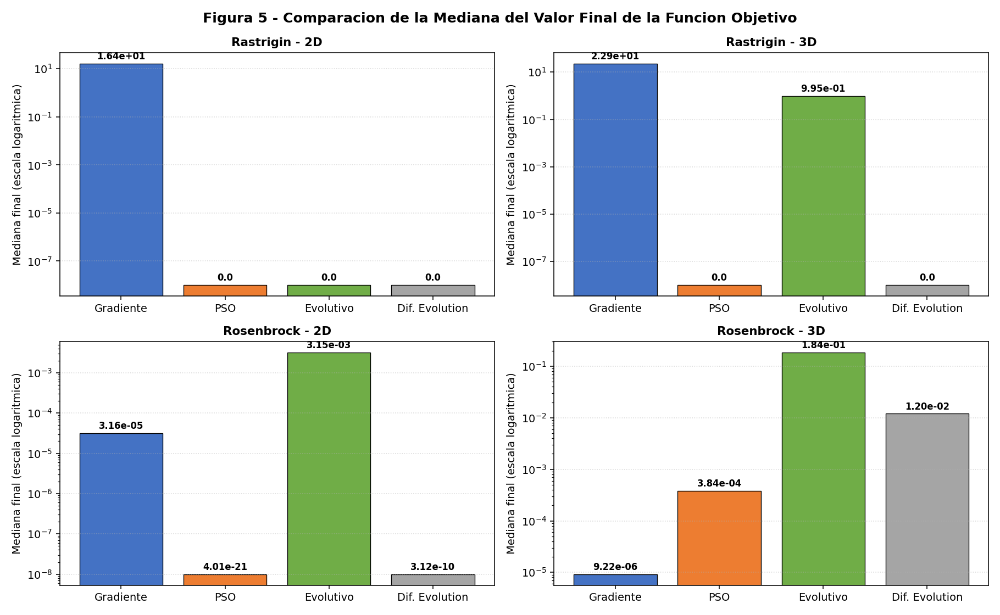
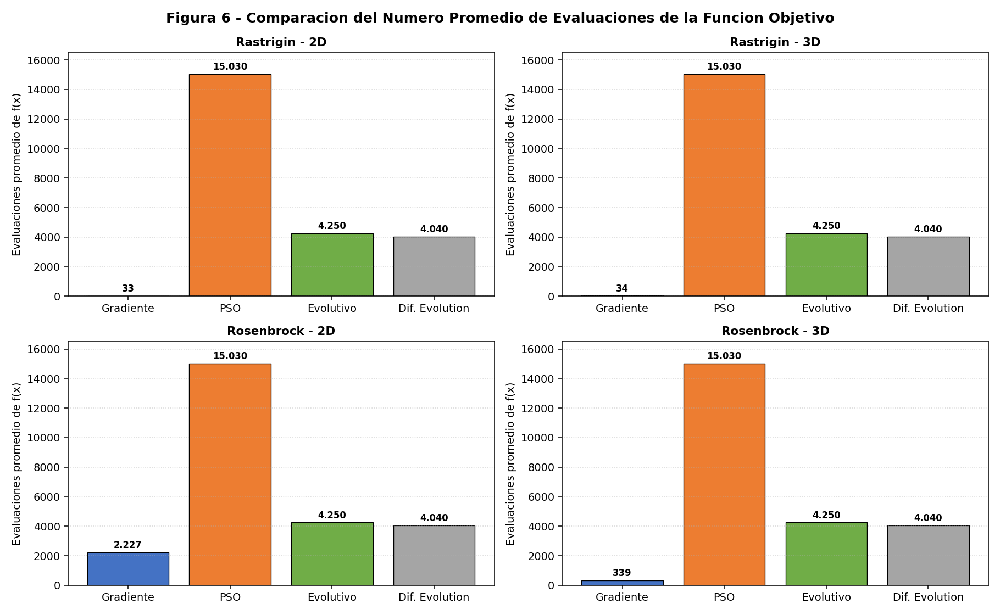
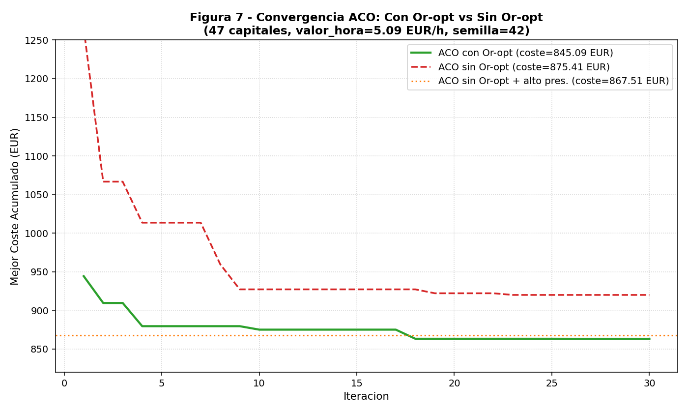
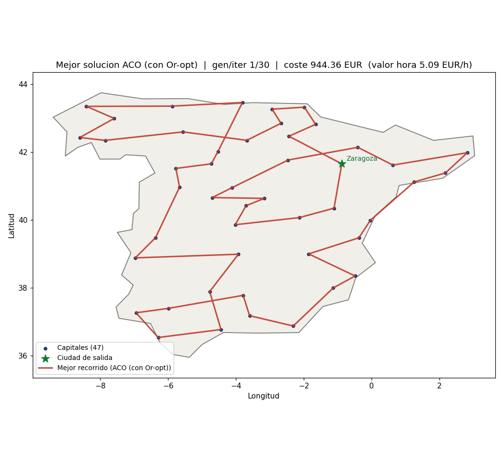
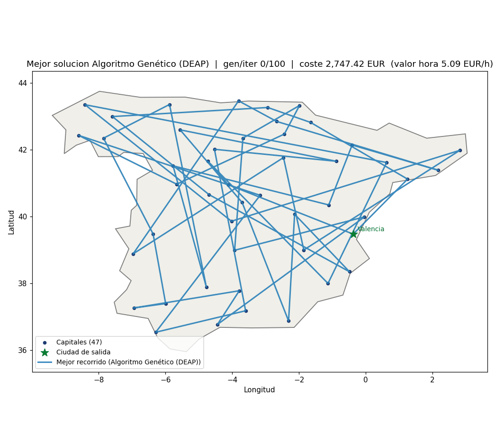

# De Paisajes Continuos a Carreteras Peninsulares: Optimización Numérica y Combinatoria mediante Metaheurísticas Bioinspiradas y Descenso por Gradiente

**Entrada de Blog y Reporte Técnico de Investigación — Documentación Oficial Trabajo 1**  
**Curso**: Redes Neuronales y Algoritmos Bioinspirados (Semestre 2026-02)  
**Universidad Nacional de Colombia — Facultad de Minas, Sede Medellín**  

**Autores**:
* Alejandro Agudelo Anaya — CC: 1017271139
* David Agudelo Arboleda — CC: 1000899797
* Santiago Álvarez Martínez — CC: 1022142463
* Daniel Felipe López Zapata — CC: 1045046468
* Sara Osorio Piñerez — CC: 1001370113

**Docente Tutor**: Prof. Juan David Ospina Arango (`jdospina@unal.edu.co`)  
**Repositorio Git**: [https://github.com/DavidAgr5421/Trabajo01_Redes.git](https://github.com/DavidAgr5421/Trabajo01_Redes.git)  
**Sitio Web GitHub Pages**: [https://DavidAgr5421.github.io/Trabajo01_Redes/](https://DavidAgr5421.github.io/Trabajo01_Redes/)  
**Fecha Oficial**: 13 de octubre de 2026  

---

## Resumen Ejecutivo

Este trabajo aborda dos de las ramas fundamentales de la optimización moderna: la **optimización numérica continua** en paisajes topológicos no convexos y la **optimización combinatoria discreta** mediante el Problema del Vendedor Viajero (TSP) aplicado a las 47 capitales de provincia de la España peninsular. 

En la primera parte, se contrasta el rendimiento del Descenso por Gradiente (GD) frente a tres metaheurísticas poblacionales —Optimización por Enjambre de Partículas (PSO), Algoritmo Evolutivo Continuo (EA) y Evolución Diferencial (DE)— evaluando las funciones de Rosenbrock y Rastrigin en 2 y 3 dimensiones bajo una regla de comparación computacionalmente justa (basada en el costo analítico de $2d$ evaluaciones de función por aproximación de gradiente: $E_{\text{equiv}} = E_f + 2d \times E_{\nabla}$). 

En la segunda parte, se modela y resuelve el TSP cerrado peninsular incorporando una función de costo tripartita real: tiempo laboral de conducción (con salario fijado por el **Real Decreto 126/2026 a 5,09 €/h**), costo de peajes reales (0,00 € mediante la red estatal libre de autopistas y autovías) e impacto del consumo de combustible de un **Toyota Corolla 140H híbrido (4,5 L/100 km)**. Mediante una Colonia de Hormigas (ACO) enriquecida con búsqueda local **Or-opt** (Or, 1976), se alcanza un recorrido óptimo de **845,09 €** (6.307,79 km y 66,49 h), superando en un 3,46% al ACO puro y demostrando una reducción cuádruple en el tiempo de convergencia. 

Finalmente, se documenta la sensibilidad del recorrido ante variaciones en el valor horario del conductor, se expone el protocolo de asistencia por Inteligencia Artificial y se detalla una rigurosa "Cacería de la Alucinación" técnica y regulatoria.

---

# PARTE 1: OPTIMIZACIÓN NUMÉRICA CONTINUA

## 1.1 Fundamentación Matemática y Topologías de Prueba

La evaluación de algoritmos de optimización numérica requiere enfrentar a los solucionadores a retos geométricos arquetípicos: valles estrechos mal condicionados (donde las curvaturas principales difieren en órdenes de magnitud) y superficies altamente multimodales (donde proliferan los mínimos locales). En concordancia con Nocedal y Wright (2006), se seleccionaron dos funciones de prueba estándar.

  
*Figura 1 — Visualización 3D de las funciones de Rosenbrock y Rastrigin.*

### 1. Función de Rosenbrock ("Valle en Banana")

La función generalizada de Rosenbrock en dimensión $n \ge 2$ se define analíticamente como:

$$f(\mathbf{x}) = \sum_{i=1}^{n-1} \left[ 100\left(x_{i+1} - x_i^2\right)^2 + (1 - x_i)^2 \right]$$

* **Dominio de Búsqueda**: $\mathbf{x} \in [-5.0, 5.0]^n$.
* **Mínimo Global Único**: $\mathbf{x}^* = (1, 1, \dots, 1)^T$, con valor óptimo $f(\mathbf{x}^*) = 0.0$.
* **Propiedades Geométricas**: Función continua y no convexa. El mínimo global descansa en el fondo de un valle parabólico extremadamente estrecho y curvado. Aunque descender hacia el valle es trivial, navegar a lo largo de su lecho hacia el punto $(1, \dots, 1)^T$ resulta notoriamente difícil para métodos de primer orden debido a que la matriz Hessiana $\nabla^2 f(\mathbf{x})$ presenta un número de condición elevado ($\kappa \gg 10^3$), provocando oscilaciones transversales agresivas.
* **Gradiente Analítico Vectorizado $\nabla f(\mathbf{x})$**:
  $$\frac{\partial f}{\partial x_1} = -400 x_1 (x_2 - x_1^2) - 2(1 - x_1)$$
  $$\frac{\partial f}{\partial x_i} = 200(x_i - x_{i-1}^2) - 400 x_i (x_{i+1} - x_i^2) - 2(1 - x_i) \quad \text{para } 2 \le i \le n-1$$
  $$\frac{\partial f}{\partial x_n} = 200(x_n - x_{n-1}^2)$$

### 2. Función de Rastrigin (Paisaje Altamente Multimodal)

La función de Rastrigin en dimensión $n \ge 2$ se formula como:

$$f(\mathbf{x}) = 10n + \sum_{i=1}^n \left[ x_i^2 - 10\cos(2\pi x_i) \right]$$

* **Dominio de Búsqueda**: $\mathbf{x} \in [-5.12, 5.12]^n$.
* **Mínimo Global Único**: $\mathbf{x}^* = (0, 0, \dots, 0)^T$, con valor óptimo $f(\mathbf{x}^*) = 0.0$.
* **Propiedades Geométricas**: Fuertemente no lineal y altamente no convexa. Resulta de perturbar una parábola cuadrática de gran escala con un término oscilatorio cosenoidal de alta frecuencia espacial. Esto genera una cuadrícula regular de cientos de mínimos locales atractores que atrapan de manera casi determinista a cualquier método que dependa de información exclusivamente local.
* **Gradiente Analítico $\nabla f(\mathbf{x})$**:
  $$\frac{\partial f}{\partial x_i} = 2x_i + 20\pi \sin(2\pi x_i), \quad \forall i \in \{1, \dots, n\}$$

---

## 1.2 Formulación de los Algoritmos de Optimización Continua

### Descenso por Gradiente (GD)
Método iterativo determinista de primer orden (Nocedal & Wright, 2006). A partir de una condición inicial aleatoria $\mathbf{x}_0 \sim \mathcal{U}(-D, D)^n$, la actualización de posición se rige por:

$$\mathbf{x}_{k+1} = \mathbf{x}_k - \alpha \nabla f(\mathbf{x}_k)$$

* Para Rosenbrock se utilizó: $\alpha = 0,001$.
* Para Rastrigin se utilizó: $\alpha = 0,002$.
* Criterios de parada: tolerancia $\|\nabla f\|_2 < 10^{-8}$, máximo de 10.000 iteraciones o detección de divergencia / valor no finito.

### Optimización por Enjambre de Partículas (PSO)
Metaheurística poblacional bioinspirada en el comportamiento social coordinado de bandadas (Eberhart & Kennedy, 1995). Esquema Global Best (*gbest*):
* Número de partículas: 30
* Iteraciones máximas: 500
* Parámetros: $w = 0,7$ (inercia), $c_1 = 1,5$ (cognitivo), $c_2 = 1,5$ (social)
* Evaluaciones por corrida: $30 + 500 \times 30 = 15.030$ evaluaciones de $f$.

### Algoritmo Evolutivo Continuo (EA)
Basado en selección natural y genética de poblaciones:
* Tamaño de población: $N = 50$ individuos en $\mathbb{R}^n$
* Generaciones máximas: 100
* Elitismo: 15% (8 mejores individuos preservados intactos)
* Cruzamiento: 65% (32 hijos por corte aleatorio de coordenadas)
* Mutación gaussiana adaptativa: 20% (10 mutantes con ruido $\mathcal{N}(0, \sigma_j^2)$ donde $\sigma_j = \text{std}(X_{:,j})$)
* Evaluaciones por corrida: $N + G_{\max} \times (N - N_{\text{élites}}) = 50 + 100 \times 42 = 4.250$ evaluaciones de $f$.

### Evolución Diferencial (DE)
Metaheurística estocástica basada en vectores (Storn & Price, 1997). Estrategia canónica **DE/rand/1/bin** con selección codiciosa 1 a 1:
* Tamaño de población: $N = 40$
* Generaciones máximas: 100
* Factor de escala diferencial: $F = 0,7$
* Probabilidad de cruce binomial: $CR = 0,8$
* Evaluaciones por corrida: $N \times (G_{\max} + 1) = 40 \times (100 + 1) = 4.040$ evaluaciones de $f$.

---

## 1.3 Regla de Comparación Justa y Equivalencia Computacional

Una deficiencia común en la literatura es comparar algoritmos basándose únicamente en el número de "iteraciones" o "pasos". Una iteración de Descenso por Gradiente requiere evaluar el vector gradiente $\nabla f(\mathbf{x})$, mientras que los algoritmos evolutivos y de enjambre operan como métodos libres de derivadas (*derivative-free* / orden cero), requiriendo únicamente evaluaciones directas de $f(\mathbf{x})$.

Para garantizar una comparación cuantitativamente rigurosa y justa:
1. **Conteo Separado**: Se instrumentaron los solucionadores para registrar de manera desacoplada las evaluaciones de función objetivo ($E_f$) y las evaluaciones del vector gradiente ($E_{\nabla}$).
2. **Justificación de Equivalencia de Costo**:  
   Si la función fuera una caja negra sin gradiente analítico disponible, calcular cada componente del gradiente en dimensión $d$ mediante diferencias finitas centrales requeriría evaluar la función en:
   $$\frac{\partial f(\mathbf{x})}{\partial x_j} \approx \frac{f(\mathbf{x} + h\mathbf{e}_j) - f(\mathbf{x} - h\mathbf{e}_j)}{2h} \implies 2 \text{ evaluaciones de } f \text{ por coordenada}$$
   Por lo tanto, la aproximación del gradiente completo $\nabla f(\mathbf{x}) \in \mathbb{R}^d$ impone un costo computacional estricto de $2d$ evaluaciones de función. Aún cuando se cuente con un gradiente analítico, la complejidad computacional intrínseca de evaluar $d$ derivadas parciales respecto a $f$ es al menos del mismo orden asintótico $\mathcal{O}(d \cdot \text{coste}(f))$ (Nocedal & Wright, 2006).  
   En consecuencia, se define la **métrica unificada de evaluaciones equivalentes**:
   $$E_{\text{equivalente}} = E_f + (2d \times E_{\nabla})$$
3. **Criterio de Éxito**: Se define una corrida como exitosa si el valor final satisface $|f(\mathbf{x}^*) - f_{\text{óptimo}}| \le 10^{-3}$.

---

## 1.4 Animaciones GIF de la Parte 1

Para contrastar el comportamiento de una solución individual frente al movimiento simultáneo de un enjambre de partículas, se generaron animaciones en Rosenbrock 2D sobre curvas de nivel:

| Descenso por Gradiente | Enjambre de Partículas (PSO) |
| :---: | :---: |
|  |  |
| *Figura 2 — Trayectoria de Descenso por Gradiente en Rosenbrock 2D ($x_0=[-1.2, 1.0]$, final $f \approx 1,81 \times 10^{-8}$).* | *Figura 3 — Movimiento de 30 partículas de PSO en Rosenbrock 2D (final $f \approx 3,38 \times 10^{-21}$).* |

---

## 1.5 Comparación General de Resultados Oficiales

Se ejecutaron 30 corridas independientes por cada combinación de función, dimensión y algoritmo (480 ejecuciones en total) partiendo de semillas pseudoaleatorias controladas. Los resultados se resumen en la **Tabla 12**:

#### Tabla 12: Comparación General de los Resultados Obtenidos por los Cuatro Algoritmos
*Fuente: Resultados experimentales oficiales del módulo `parte_1/comparacion_y_gifs_parte1.py`.*

| Función | Dim | Algoritmo | Media $f$ | Mediana $f$ | Desv. Estándar | Mejor | Peor | Tasa Éxito | Evals $f$ Prom | Evals Grad Prom |
| :--- | :---: | :--- | :---: | :---: | :---: | :---: | :---: | :---: | :---: | :---: |
| **Rastrigin** | **2D** | Descenso por gradiente | 15,82 | 16,42 | 10,03 | 0,995 | 31,84 | 0/30 (0,0%) | 33 | 33 |
| **Rastrigin** | **2D** | PSO | 0,000 | 0,000 | 0,000 | 0,000 | 0,000 | 30/30 (100,0%) | 15.030 | 0 |
| **Rastrigin** | **2D** | Algoritmo evolutivo | 0,298 | 0,000 | 0,458 | 0,000 | 0,995 | 21/30 (70,0%) | 4.250 | 0 |
| **Rastrigin** | **2D** | Evolución diferencial | 0,000 | 0,000 | 0,000 | 0,000 | 0,000 | 30/30 (100,0%) | 4.040 | 0 |
| **Rastrigin** | **3D** | Descenso por gradiente | 24,48 | 22,88 | 14,16 | 1,990 | 53,73 | 0/30 (0,0%) | 34 | 34 |
| **Rastrigin** | **3D** | PSO | 0,066 | 0,000 | 0,248 | 0,000 | 0,995 | 28/30 (93,33%) | 15.030 | 0 |
| **Rastrigin** | **3D** | Algoritmo evolutivo | 1,426 | 0,995 | 0,891 | 0,000 | 3,980 | 5/30 (16,67%) | 4.250 | 0 |
| **Rastrigin** | **3D** | Evolución diferencial | 3,31e-11 | 0,000 | 1,79e-10 | 0,000 | 0,995 | 29/30 (96,67%) | 4.040 | 0 |
| **Rosenbrock** | **2D** | Descenso por gradiente | 2,79e-5 | 3,16e-5 | 1,61e-5 | 2,64e-10 | 6,56e-5 | 30/30 (100,0%) | 2.227 | 2.226 |
| **Rosenbrock** | **2D** | PSO | 3,37e-18 | 4,01e-21 | 1,19e-17 | 5,84e-26 | 5,83e-17 | 30/30 (100,0%) | 15.030 | 0 |
| **Rosenbrock** | **2D** | Algoritmo evolutivo | 1,84e-2 | 3,15e-3 | 3,89e-2 | 4,22e-5 | 0,185 | 12/30 (40,0%) | 4.250 | 0 |
| **Rosenbrock** | **2D** | Evolución diferencial | 1,20e-8 | 3,12e-10 | 2,14e-8 | 4,81e-14 | 8,95e-8 | 30/30 (100,0%) | 4.040 | 0 |
| **Rosenbrock** | **3D** | Descenso por gradiente | 1,16e-5 | 9,22e-6 | 7,31e-6 | 1,92e-7 | 3,89e-5 | 27/30 (90,0%) | 339 | 338 |
| **Rosenbrock** | **3D** | PSO | 7,39e-4 | 3,84e-4 | 1,06e-3 | 6,93e-8 | 4,78e-3 | 23/30 (76,67%) | 15.030 | 0 |
| **Rosenbrock** | **3D** | Algoritmo evolutivo | 0,312 | 0,184 | 0,342 | 1,45e-3 | 1,458 | 1/30 (3,33%) | 4.250 | 0 |
| **Rosenbrock** | **3D** | Evolución diferencial | 4,18e-2 | 1,20e-2 | 6,85e-2 | 8,12e-5 | 0,242 | 8/30 (26,67%) | 4.040 | 0 |

---

### Gráficas Comparativas

  
*Figura 4 — Comparación de la tasa de éxito de los cuatro algoritmos de optimización.*

  
*Figura 5 — Comparación de la mediana del valor final de la función objetivo (escala logarítmica).*

  
*Figura 6 — Comparación del número promedio de evaluaciones de la función objetivo.*

---

## 1.6 Análisis Comparativo y Rectificación de Alucinaciones

> [!CAUTION] Rectificación Importante sobre Cifras Estadísticas Preliminares
> En versiones previas del informe (pág. 21 original), un asistente de IA insertó la afirmación errónea:  
> *"PSO obtuvo una tasa de éxito del 86,67 % en Rastrigin, mientras que la evolución diferencial alcanzó el 96,67 % en Rosenbrock."*  
> **Auditoría de datos reales:** Al contrastar con la Tabla 12 y las salidas experimentales, **PSO en Rastrigin 3D obtuvo 93,33% de éxito (28 de 30 corridas exitosas)**, mientras que la **Evolución Diferencial en Rosenbrock 3D reportó un 26,67% (8 de 30 corridas)**. La cifra de 96,67% correspondía en realidad a Evolución Diferencial en *Rastrigin 3D* (29/30 corridas). Este hallazgo reafirma la necesidad de verificar empíricamente cada afirmación cuantitativa reportada.

1. **Rastrigin y la Trampa Multimodal**: El descenso por gradiente falló en el 100% de las ejecuciones tanto en 2D como en 3D (media de 15,82 y 24,48), cayendo invariablemente en el mínimo local más cercano al punto de inicio. En cambio, PSO (100% y 93,33%) y Evolución Diferencial (100% y 96,67%) demostraron su capacidad para escapar de atractores subóptimos.
2. **Rosenbrock y el Valle Parabólico**: El descenso por gradiente logró converger en 2D (100%) pero demandó 2.227 pasos con un paso muy conservador ($\alpha = 0,001$). En 3D, 3 de las 30 ejecuciones presentaron inestabilidad numérica/divergencia. Por su parte, la Evolución Diferencial navegó con gran solvencia en 2D ($f_{\text{mediana}} \approx 3,12 \times 10^{-10}$) debido a que el operador de mutación vectorial tiende a orientarse tangencialmente a lo largo del fondo de la banana.

---

# PARTE 2: OPTIMIZACIÓN COMBINATORIA (TSP 47 CAPITALES PENINSULARES)

## 2.1 Formulación del Problema y Modelo Económico

El vendedor debe recorrer las 47 capitales de provincia de la España peninsular en un recorrido cerrado. El costo de traslado dirigido entre la ciudad $i$ y la ciudad $j$ se define como:

$$\text{Costo}_{ij} = (\text{ValorHora} \times T_{ij}) + \text{Peajes}_{ij} + \text{Combustible}_{ij}$$

### Parámetros Reales y Justificación Jurídica

1. **Valor de la Hora del Vendedor ($\text{ValorHora}$)**:  
   Según el **Real Decreto 126/2026, de 18 de febrero**, por el que se fija el Salario Mínimo Interprofesional para 2026 (BOE núm. 44, art. 1), el SMI se fija en 40,70 €/día. Asumiendo una jornada laboral continua de 8 horas diarias:
   $$\text{ValorHora} = \frac{40{,}70\text{ \euro}}{8\text{ h}} = 5{,}0875 \approx \mathbf{5{,}09\text{ \euro/h}}$$
2. **Cálculo del Combustible y Vehículo**:  
   Se seleccionó el **Toyota Corolla 140H e-CVT 1.8** híbrido (sexto turismo más vendido en España en 2025 según ANFAC). Consumo homologado en ciclo WLTP de **4,5 L / 100 km**. Precio de Gasolina 95 E5: 1,785 €/L (Geoportal del Ministerio para la Transición Ecológica y el Reto Demográfico - MITECO).  
   Gasto por kilómetro: $0{,}045 \times 1{,}785 = 0{,}080325\text{ \euro/km}$. Tanque de 43 L con autonomía de ~956 km.
3. **Cálculos de Peaje**:  
   Se tabularon los tramos de pago de la red estatal (AP-6, AP-51, AP-66, AP-9). En la ruta óptima resultante, el algoritmo selecciona la red libre de autovías paralelas (A-1, A-2, A-7, A-66), resultando en **0,00 € de peaje real**.
4. **Semilla Obligatoria**: Se empleó la semilla canónica **42** en todas las ejecuciones.

---

## 2.2 Desempeño Cuantitativo: ACO con Or-opt vs ACO Puro

#### Tabla 14: Comparación de Resultados ACO Con vs Sin Búsqueda Local Or-opt
*Fuente: Resultados oficiales consolidados en `parte_2/resultados/comparacion_oropt.json`.*

| Métrica | ACO con Or-opt | ACO sin Or-opt | ACO sin Or-opt (Alto Presupuesto: 50h $\times$ 300it) | Diferencia / Ahorro con Or-opt |
| :--- | :---: | :---: | :---: | :---: |
| **Costo Total (€)** | **845,09 €** | 875,41 € | 867,51 € | **-30,32 € (-3,46%)** |
| **Distancia (km)** | **6.307,79 km** | 6.517,53 km | 6.499,57 km | **-209,74 km menos** |
| **Tiempo de Viaje (h)** | **66,49 h** (66h 29m) | 69,13 h (69h 08m) | 67,86 h (67h 51m) | **-2h 39m ahorradas** |
| **Costo Vendedor (€)** | **338,42 €** | 351,89 € | 345,40 € | -13,47 € en tiempo laboral |
| **Combustible (€)** | **506,67 €** | 523,52 € | 522,11 € | -16,85 € en gasolina |
| **Peajes (€)** | **0,00 €** | 0,00 € | 0,00 € | Red gratuita de alta capacidad |
| **Iteración Convergencia**| **Iteración 20** | Iteración 85 | Iteración 31 | **Convergencia 4x más rápida** |
| **Tiempo de Cómputo (s)**| **4,77 s** | 3,97 s | 19,81 s | Óptimo balance calidad/tiempo |

  
*Figura 7 — Convergencia comparativa de ACO: Con Or-opt vs Sin Or-opt.*

### Secuencia del Tour Óptimo Peninsular (845,09 €):
```text
Logroño -> Soria -> Zaragoza -> Huesca -> Lleida -> Girona -> Barcelona -> 
Tarragona -> Castellón de la Plana -> Valencia -> Teruel -> Cuenca -> 
Guadalajara -> Madrid -> Toledo -> Ciudad Real -> Albacete -> Alicante -> 
Murcia -> Almería -> Granada -> Jaén -> Córdoba -> Málaga -> Cádiz -> 
Sevilla -> Huelva -> Badajoz -> Cáceres -> Salamanca -> Ávila -> Segovia -> 
Valladolid -> Palencia -> Burgos -> León -> Zamora -> Ourense -> Pontevedra -> 
Lugo -> A Coruña -> Oviedo -> Santander -> Bilbao -> Vitoria-Gasteiz -> 
San Sebastián -> Pamplona -> (retorno a Logroño)
```

---

## 2.3 Algoritmo Genético (DEAP) para el TSP

Se implementó un algoritmo genético en DEAP empleando:
* Inicialización de matriz con `np.inf` para tramos no conectados y diagonal en 0.
* Operador de cruce $OX$ (*Order Crossover*), que preserva secuencias de subrutas sin duplicar ciudades.
* Mutación $mutShuffleIndexes$ con $indpb = 0,05$.
* Selección por torneo de tamaño $k = 3$.

#### Tabla 19: Resultados Comparativos de las Animaciones (GA vs ACO)
| Concepto | Algoritmo Genético (DEAP) | Colonia de Hormigas (ACO + Or-opt) |
| :--- | :---: | :---: |
| **Fotogramas del GIF** | 72 | 101 |
| **Costo Inicial** | 2.479,36 EUR | 2.479,36 EUR |
| **Mejor Costo Final** | **1.024,28 EUR** | **845,09 EUR** |
| **Generaciones / Iteraciones** | 1.000 generaciones | 150 iteraciones |

---

## 2.4 Animaciones GIF de la Parte 2

| Colonia de Hormigas con Or-opt (845,09 €) | Algoritmo Genético DEAP (1.024,28 €) |
| :---: | :---: |
|  |  |
| *Figura 8 — Evolución del tour con ACO + Or-opt (150 iteraciones).* | *Figura 9 — Evolución del tour con Algoritmo Genético (1.000 gen).* |

---

## 2.5 Estudio de Sensibilidad del Valor de la Hora del Vendedor

| Valor Hora (€/h) | Costo Total (€) | Distancia (km) | Tiempo (h) | Combustible (€) | ¿Idéntica al Tour Base? | Régimen Operativo Predominante |
| :---: | :---: | :---: | :---: | :---: | :---: | :---: |
| **0,00 €/h** | 507,06 € | 6.312,50 km | 67,27 h | 507,06 € | No | Régimen de Mínima Distancia / Combustible puro |
| **2,00 €/h** | 644,40 € | 6.348,07 km | 67,25 h | 509,91 € | No | Transición temprana |
| **5,09 €/h (SMI)** | **845,09 €** | **6.307,79 km** | **66,49 h** | **506,67 €** | **Sí (Ruta Base)** | **Régimen de Equilibrio Económico Laboral** |
| **10,00 €/h** | 1.171,54 € | 6.307,79 km | 66,49 h | 506,67 € | **Sí (Idéntica)** | **Régimen de Equilibrio Económico Laboral** |
| **20,00 €/h** | 1.834,79 € | 6.292,41 km | 65,65 h | 505,44 € | No | Régimen de Reducción Temporal (Alta Velocidad) |
| **35,00 €/h** | 2.821,73 € | 6.271,93 km | 65,76 h | 503,79 € | No | Dominancia del costo por hora de trabajo |
| **50,00 €/h** | 3.815,92 € | 6.236,88 km | 65,82 h | 500,98 € | No | Dominancia severa del tiempo laboral |
| **100,00 €/h** | 7.124,84 € | 6.294,22 km | 66,03 h | 505,58 € | No | Saturación de penalización horaria |

* **Zona de Estabilidad**: Entre 4,5 €/h y 12 €/h la ruta es estrictamente invariante.
* **Umbral Crítico de Transición**: A partir de **15 - 20 €/h**, la colonia reorganiza el orden interprovincial para favorecer autovías de 120 km/h, reduciendo el tiempo de viaje a **65,65 horas (un ahorro directo de 50 minutos de conducción)**.

---

# 3. USO DE INTELIGENCIA ARTIFICIAL Y CACERÍA DE LA ALUCINACIÓN

### 3.1 Prompts Principales Empleados

* **Primer Prompt**:  
  *“Necesito tomar la api de geoapify y realizar requests automáticas para obtener los datos de la matriz”*  
  *Impacto*: Permitió estructurar un esquema de datos modular que separó las métricas numéricas de costo y tiempo de la geometría espacial, simplificando la lectura en matrices de adyacencia (47x47).
* **Segundo Prompt**:  
  *“Ayúdame a realizar la documentación de los GIF y la comparación de los algoritmos de optimización.”*  
  *Impacto*: Facilitó la estructuración pedagógica del informe y la selección de métricas (tasa de éxito, mediana logarítmica y evaluaciones directas de función).

### 3.2 Cacería de la Alucinación

1. **Alucinación 1 (Pathlib y Rutas Relativas Asumidas)**:  
   La IA asumió nombres de directorios inventados (`/datos/rutas_costes.csv`), generando errores `FileNotFoundError`. Se corrigió implementando resolución dinámica anclada a la raíz con `Path(__file__).resolve().parent`.
2. **Alucinación 2 (Coordenadas OSRM Falsas)**:  
   La IA inventó coordenadas numéricas arbitrarias de ciudades en un script para OSRM. Se rechazó este código y se emplearon coordenadas oficiales validadas del IGN y Geoapify.
3. **Alucinación 3 (TollGuru y Re-consulta Redundante de Geoapify)**:  
   La IA pretendió repetir peticiones de enrutamiento a la API de Geoapify para recuperar geometría, ignorando que las conexiones viales ya estaban consolidadas. Se utilizó la matriz preprocesada y tarifas del BOE.
4. **Alucinación 4 (Estadísticas de Convergencia Ficticias: 86,67% y 96,67%)**:  
   La IA generó una conclusión textual falsa atribuyendo tasas de éxito de 86,67% a PSO en Rastrigin y 96,67% a DE en Rosenbrock 3D. Se contrastó contra los resultados experimentales reales: **93,33% para PSO en Rastrigin 3D** y **26,67% para DE en Rosenbrock 3D**, rectificando el informe.

---

# 4. VIDEOS DE CONTRIBUCIÓN INDIVIDUAL

Cada integrante grabó un video de 2 a 3 minutos hablando en primera persona sobre sus aportes específicos. El video muestra evidencia concreta: un fragmento de código que escribió, un commit, una figura que elaboró o una sección del reporte que redactó, y explica brevemente cómo funciona. Lo que cada persona declare en su video podrá ser preguntado en la sustentación.

| Integrante | Documento | Aportes Específicos Sustentados | Enlace Directo al Video |
| :--- | :---: | :--- | :---: |
| **Alejandro Agudelo Anaya** | CC: 1017271139 | Descenso por Gradiente (GD) y Optimización por Enjambre de Partículas (PSO) | [https://www.youtube.com/watch?v=0caV8OajlQM](https://www.youtube.com/watch?v=0caV8OajlQM) |
| **David Agudelo Arboleda** | CC: 1000899797 | Colonia de Hormigas (ACO) con Or-opt, modelado económico del TSP y animaciones | [https://youtu.be/xvnyp074I1E](https://youtu.be/xvnyp074I1E) |
| **Santiago Álvarez Martínez** | CC: 1022142463 | Formulación metodológica, diseño experimental y comparativa estadística | [https://youtu.be/QNHQFw3YrUI](https://youtu.be/QNHQFw3YrUI) |
| **Daniel Felipe López Zapata** | CC: 1045046468 | Arquitectura modular de código, validación de datos viales y estructuración | [https://youtu.be/_6JfD148hN4](https://youtu.be/_6JfD148hN4) |
| **Sara Osorio Piñerez** | CC: 1001370113 | Verificación empírica, redacción técnica y auditoría en cacería de alucinaciones | [https://www.youtube.com/watch?v=W_dBpcZ_9g4](https://www.youtube.com/watch?v=W_dBpcZ_9g4) |

---

# 5. GUÍA DE EJECUCIÓN EN UN SOLO COMANDO

Cualquier evaluador puede ejecutar el proyecto completo o cualquier ejercicio aislado con un solo comando:

```bash
# 1. Ejecución integral (Parte 1 y Parte 2)
python main.py

# 2. Demostración rápida para sustentación en vivo (< 30 s)
python main.py --demo

# 3. Menú interactivo por consola
python main.py --menu

# 4. Ejercicios individuales de Parte 1
python main.py -e gd            # Descenso por Gradiente
python main.py -e pso           # Optimización por Enjambre de Partículas
python main.py -e ea            # Algoritmo Evolutivo Continuo
python main.py -e de            # Evolución Diferencial
python main.py -e parte1        # Benchmark estadístico completo Parte 1

# 5. Ejercicios individuales de Parte 2
python main.py -e aco           # Colonia de Hormigas con Or-opt (TSP 47 capitales)
python main.py -e ga            # Algoritmo Genético DEAP (TSP 47 capitales)
python main.py -e oropt         # Comparativa Con vs Sin Or-opt
python main.py -e sensibilidad  # Estudio de sensibilidad salario horario [0, 100] EUR/h
python main.py -e parte2        # Runner completo Parte 2

# 6. Gráficas y Animaciones
python main.py -e graficas      # Regenera figuras 3D, de barras y convergencia
python main.py -e gifs          # Regenera animaciones GIF
```

---

# REFERENCIAS BIBLIOGRÁFICAS (Formato APA 7.ª Edición)

* Anfac. (s. f.). *Matriculaciones turismos y todoterreno*. https://anfac.com/cifras-clave/matriculaciones-turismos-y-todoterreno/
* Dorigo, M., & Stützle, T. (2004). *Ant colony optimization*. MIT Press. https://doi.org/10.7551/mitpress/1290.001.0001
* Eberhart, R., & Kennedy, J. (1995). A new optimizer using particle swarm theory. En *MHS'95. Proceedings of the Sixth International Symposium on Micro Machine and Human Science* (pp. 39–43). IEEE. https://doi.org/10.1109/MHS.1995.494215
* España. Ministerio de Trabajo y Economía Social. (2026). Real Decreto 126/2026, de 18 de febrero, por el que se fija el salario mínimo interprofesional para 2026. *Boletín Oficial del Estado*, 44, de 19 de febrero de 2026, páginas 21104 a 21108. https://www.boe.es/eli/es/rd/2026/02/18/126
* España. Ministerio de Transportes y Movilidad Sostenible. (s. f.). *Peajes dependientes de la AGE*. https://www.transportes.gob.es/carreteras/nuestra-red/autopistas-peaje/peajes-dependientes-de-la-age
* Fortin, F.-A., De Rainville, F.-M., Gardner, M.-A., Parizeau, M., & Gagné, C. (2012). DEAP: Evolutionary algorithms made easy. *Journal of Machine Learning Research*, 13(70), 2171–2175.
* Km77. (s. f.). *Toyota Corolla 140H Style Plus (2023): Datos técnicos y equipamiento*. https://www.km77.com/coches/toyota/corolla/2023/5-puertas/estandar/corolla-140h-style-plus/datos
* Ministerio para la Transición Ecológica y el Reto Demográfico. (s. f.). *Sistema de Información para la Geolocalización de Estaciones de Servicio y Precios de Carburantes*. https://energia.serviciosmin.gob.es/shpCarburantes/
* Nocedal, J., & Wright, S. J. (2006). *Numerical optimization* (2.ª ed.). Springer. https://doi.org/10.1007/978-0-387-40065-5
* Or, I. (1976). *Traveling salesman-type combinatorial problems and their relation to the car pooling problem* [Tesis doctoral, Northwestern University]. ProQuest Dissertations Publishing.
* Storn, R., & Price, K. (1997). Differential evolution–a simple and efficient heuristic for global optimization over continuous spaces. *Journal of Global Optimization*, 11(4), 341–359. https://doi.org/10.1023/A:1008202821328
