# De Paisajes Continuos a Carreteras Peninsulares: Optimización Numérica y Combinatoria mediante Metaheurísticas Bioinspiradas y Descenso por Gradiente

**Entrada de Blog y Reporte Técnico de Investigación — Documentación Oficial Trabajo 1**  
**Curso**: Redes Neuronales y Algoritmos Bioinspirados (Semestre 2026-02)  
**Universidad Nacional de Colombia — Facultad de Minas, Sede Medellín**  

**Autores**:
* Alejandro Agudelo Anaya
* David Agudelo Arboleda
* Santiago Álvarez Martínez
* Daniel Felipe López Zapata
* Sara Osorio Piñerez

**Docente Tutor**: Prof. Juan David Ospina Arango (`jdospina@unal.edu.co`)  
**Repositorio Git**: [https://github.com/DavidAgr5421/Trabajo01_Redes.git](https://github.com/DavidAgr5421/Trabajo01_Redes.git)  
**Sitio Web GitHub Pages**: [https://DavidAgr5421.github.io/Trabajo01_Redes/](https://DavidAgr5421.github.io/Trabajo01_Redes/)  
**Fecha Oficial**: 13 de octubre de 2026  

---

## Resumen Ejecutivo

Este trabajo aborda dos de las ramas fundamentales de la optimización moderna: la **optimización numérica continua** en paisajes topológicos no convexos y la **optimización combinatoria discreta** mediante el Problema del Vendedor Viajero (TSP) aplicado a las 47 capitales de provincia de la España peninsular. 

En la primera parte, se contrasta el rendimiento del Descenso por Gradiente (GD; Nocedal & Wright, 2006) frente a tres metaheurísticas poblacionales —Optimización por Enjambre de Partículas (PSO; Eberhart & Kennedy, 1995), Algoritmo Evolutivo Continuo (EA; Eiben & Smith, 2015) y Evolución Diferencial (DE; Storn & Price, 1997)— evaluando las funciones de Rosenbrock y Rastrigin en 2 y 3 dimensiones bajo **igualdad estricta de esfuerzo computacional** (tope común de $15.000$ evaluaciones equivalentes bajo la regla $E_{\text{equiv}} = E_f + 2n \times E_{\nabla}$). 

En la segunda parte, se formula el TSP cerrado y asimétrico peninsular como un problema de optimización sobre permutaciones (y como programa lineal entero de referencia), incorporando una función de costo tripartita real: tiempo laboral de conducción (con salario fijado por el **Real Decreto 126/2026 a 5,09 €/h**; España. Ministerio de Trabajo y Economía Social, 2026), costo de peajes oficiales vigentes en 2026 (consolidado mediante la API gratuita de Geoapify, el motor abierto OSRM y el inventario oficial de MITMA, BOE, SEITT y las concesionarias, cubriendo los 2.162 arcos dirigidos) e impacto del consumo de combustible de un **Toyota Corolla 140H híbrido (4,5 L/100 km**; Toyota España, 2026; Km77, 2023). Mediante una Colonia de Hormigas (ACO; Dorigo & Stützle, 2004) enriquecida con búsqueda local **Or-opt** (Or, 1976), se alcanza el mejor recorrido encontrado a salario mínimo ($h = 5{,}09$ €/h), de **879,35 €** (**6.452,60 km**, **67,73 h** y **16,28 € en peajes reales** concentrados en cuatro enlaces donde el rodeo resulta antieconómico), superando en un 2,43% al ACO sin Or-opt (901,24 € y 37,98 € en peajes) y alcanzando la solución en una convergencia 3,8 veces más rápida. 

Finalmente, se documenta la sensibilidad del recorrido y del gasto en peajes ante variaciones en el valor horario del conductor ($h \in [0, 100]$ €/h), se expone el protocolo de asistencia por Inteligencia Artificial y se detalla una rigurosa "Cacería de la Alucinación" técnica y regulatoria.

---

# PARTE 1: OPTIMIZACIÓN NUMÉRICA CONTINUA

## 1.1 Fundamentación Matemática y Topologías de Prueba

### 1.1.1 Planteamiento general

Se aborda el problema de minimización con restricciones de caja

$$\min_{\mathbf{x} \in \mathcal{D}} f(\mathbf{x}), \qquad \mathcal{D} = [-D, D]^n \subset \mathbb{R}^n, \qquad f : \mathbb{R}^n \to \mathbb{R}, \qquad n \in \{2, 3\},$$

donde $D$ es el semiancho del dominio de búsqueda y $n$ la dimensión del problema. En todo el documento $\|\cdot\|_2$ denota la norma euclídea, $\mathbf{e}_j$ el $j$-ésimo vector canónico y $\odot$ el producto elemento a elemento.

La evaluación de algoritmos de optimización numérica requiere enfrentar a los solucionadores a retos geométricos arquetípicos: valles estrechos mal condicionados (donde las curvaturas principales difieren en órdenes de magnitud) y superficies altamente multimodales (donde proliferan los mínimos locales). En concordancia con Rosenbrock (1960), Rastrigin (1974) y Nocedal y Wright (2006), se seleccionaron dos funciones de prueba estándar, cuyas propiedades se resumen en la **Tabla 1** y cuyas topologías tridimensionales se ilustran en la **Figura 1**.

#### Tabla 1: Dominios, Óptimos Globales y Propiedades Geométricas de las Funciones de Prueba
*Fuente: Elaboración propia a partir de Rosenbrock (1960), Rastrigin (1974) y Nocedal y Wright (2006).*

| Propiedad | Rosenbrock | Rastrigin |
| :--- | :---: | :---: |
| **Dominio natural de $f$** | $\mathbb{R}^n$ ($f \in C^{\infty}$) | $\mathbb{R}^n$ ($f \in C^{\infty}$) |
| **Dominio de búsqueda $\mathcal{D}$** | $[-5.0,\, 5.0]^n$ ($D=5.0$) | $[-5.12,\, 5.12]^n$ ($D=5.12$) |
| **Dominio del gradiente** | $\nabla f : \mathbb{R}^n \to \mathbb{R}^n$ | $\nabla f : \mathbb{R}^n \to \mathbb{R}^n$ |
| **Imagen / cota inferior** | $f(\mathbf{x}) \ge 0$ | $f(\mathbf{x}) \ge 0$ |
| **Mínimo global** | $\mathbf{x}^* = (1,\dots,1)^T \in \mathrm{int}(\mathcal{D})$, $f(\mathbf{x}^*) = 0$ | $\mathbf{x}^* = \mathbf{0} \in \mathrm{int}(\mathcal{D})$, $f(\mathbf{x}^*) = 0$ |
| **Convexidad** | No convexa | No convexa |
| **Modalidad** | Un solo punto estacionario en $n \in \{2,3\}$; valle estrecho | $\approx 11^n$ mínimos locales en $\mathcal{D}$ ($\approx 121$ en 2D; $\approx 1.331$ en 3D) |
| **Número de condición de $\nabla^2 f(\mathbf{x}^*)$** | $\kappa \approx 2{,}5 \times 10^3$ ($n=2$); $\kappa \approx 2{,}9 \times 10^3$ ($n=3$) | $\kappa = 1$ |

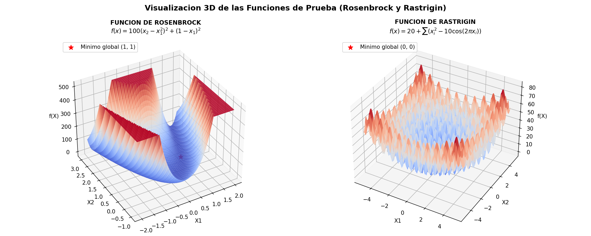  
*Figura 1 — Visualización 3D de las superficies de prueba de Rosenbrock y Rastrigin en dos dimensiones. Fuente: Elaboración propia generada con `generar_graficas.py` a partir de Rosenbrock (1960) y Rastrigin (1974).*

### 1. Función de Rosenbrock ("Valle en Banana")

La función generalizada de Rosenbrock (1960) en dimensión $n \ge 2$ se define analíticamente como:

$$f(\mathbf{x}) = \sum_{i=1}^{n-1} \left[ 100\left(x_{i+1} - x_i^2\right)^2 + (1 - x_i)^2 \right]$$

* **Dominio de Búsqueda**: $\mathbf{x} \in [-5.0, 5.0]^n$.
* **Cota inferior y mínimo global**: $f$ es una suma de cuadrados, por lo que $f(\mathbf{x}) \ge 0$. La igualdad exige $x_i = 1$ para $i = 1,\dots,n-1$ (segundo sumando) y $x_{i+1} = x_i^2$ (primer sumando), lo que implica $x_n = 1$. Por tanto, el mínimo global es $\mathbf{x}^* = (1, 1, \dots, 1)^T$, con valor óptimo $f(\mathbf{x}^*) = 0.0$, y es el único punto estacionario en las dimensiones empleadas ($n \in \{2, 3\}$).
* **Propiedades Geométricas**: Función continua y no convexa. El mínimo global descansa en el fondo de un valle parabólico ($x_{i+1} = x_i^2$) extremadamente estrecho y curvado. Aunque descender hacia el valle es trivial, navegar a lo largo de su lecho hacia el punto $(1, \dots, 1)^T$ resulta notoriamente difícil para métodos de primer orden debido al mal condicionamiento de la Hessiana, que provoca oscilaciones transversales agresivas (Nocedal & Wright, 2006).
* **Gradiente Analítico Vectorizado $\nabla f(\mathbf{x})$**:
  $$\frac{\partial f}{\partial x_1} = -400 x_1 (x_2 - x_1^2) - 2(1 - x_1)$$
  $$\frac{\partial f}{\partial x_i} = 200(x_i - x_{i-1}^2) - 400 x_i (x_{i+1} - x_i^2) - 2(1 - x_i) \quad \text{para } 2 \le i \le n-1$$
  $$\frac{\partial f}{\partial x_n} = 200(x_n - x_{n-1}^2)$$
* **Hessiana $\nabla^2 f(\mathbf{x})$** (tridiagonal y simétrica):
  $$H_{11} = 1200x_1^2 - 400x_2 + 2, \qquad H_{ii} = 202 + 1200x_i^2 - 400x_{i+1} \;\; (2 \le i \le n-1), \qquad H_{nn} = 200,$$
  $$H_{i,i+1} = H_{i+1,i} = -400\,x_i .$$
  En el óptimo para $n=2$: $\nabla^2 f(\mathbf{x}^*) = \begin{pmatrix} 802 & -400 \\ -400 & 200 \end{pmatrix}$, con autovalores $\lambda_{\max} \approx 1001{,}6$ y $\lambda_{\min} \approx 0{,}399$ (su producto es $\det = 400$), de modo que $\kappa = \lambda_{\max}/\lambda_{\min} \approx 2{,}5 \times 10^3$. Para $n = 3$ se obtiene $\lambda_{\max} \approx 1{,}40 \times 10^3$, $\lambda_{\min} \approx 0{,}475$ y $\kappa \approx 2{,}9 \times 10^3$. Ambas Hessianas son definidas positivas, por lo que $\mathbf{x}^*$ es un mínimo estricto.

### 2. Función de Rastrigin (Paisaje Altamente Multimodal)

La función de Rastrigin (1974) en dimensión $n \ge 2$ se formula como:

$$f(\mathbf{x}) = 10n + \sum_{i=1}^n \left[ x_i^2 - 10\cos(2\pi x_i) \right] = \sum_{i=1}^n \left[ x_i^2 + 10\bigl(1 - \cos(2\pi x_i)\bigr) \right]$$

* **Dominio de Búsqueda**: $\mathbf{x} \in [-5.12, 5.12]^n$.
* **Cota inferior y mínimo global**: en la segunda forma, cada sumando es no negativo ($x_i^2 \ge 0$ y $1 - \cos(\cdot) \ge 0$) y solo se anula en $x_i = 0$. El mínimo global único es $\mathbf{x}^* = (0, 0, \dots, 0)^T$, con valor óptimo $f(\mathbf{x}^*) = 0.0$.
* **Propiedades Geométricas**: Fuertemente no lineal y altamente no convexa. Resulta de perturbar una parábola cuadrática de gran escala con un término oscilatorio cosenoidal de alta frecuencia espacial. Cada coordenada aporta un mínimo local cerca de cada entero $k$ con $|k| \le 5$, por lo que en $\mathcal{D}$ existen aproximadamente $11^n$ mínimos locales, con valor $f \approx \sum_i k_i^2$. Esto genera una cuadrícula regular de atractores que atrapa de manera casi determinista a cualquier método que dependa de información exclusivamente local.
* **Gradiente Analítico $\nabla f(\mathbf{x})$**:
  $$\frac{\partial f}{\partial x_i} = 2x_i + 20\pi \sin(2\pi x_i), \quad \forall i \in \{1, \dots, n\}$$
* **Hessiana $\nabla^2 f(\mathbf{x})$** (diagonal, pues la función es separable):
  $$\frac{\partial^2 f}{\partial x_i^2} = 2 + 40\pi^2 \cos(2\pi x_i), \qquad \frac{\partial^2 f}{\partial x_i \partial x_j} = 0 \;\; (i \ne j).$$
  En el óptimo, $\nabla^2 f(\mathbf{0}) = (2 + 40\pi^2)\,I \approx 396{,}8\, I$, es decir, $\kappa = 1$: localmente Rastrigin es perfectamente condicionada y su dificultad es exclusivamente la multimodalidad, en contraste con Rosenbrock, cuya dificultad es el condicionamiento.

---

## 1.2 Formulación de los Algoritmos de Optimización Continua

En todos los casos, la posición de un individuo es $\mathbf{x} \in \mathcal{D} \subset \mathbb{R}^n$ y el objetivo es minimizar $f$. Los dominios admisibles de los hiperparámetros y los valores empleados en el protocolo experimental se consolidan en la **Tabla 2**.

### Descenso por Gradiente (GD)
Método iterativo determinista de primer orden (Nocedal & Wright, 2006). A partir de una condición inicial aleatoria $\mathbf{x}_0 \sim \mathcal{U}(-D, D)^n$, la actualización de posición se rige por:

$$\mathbf{x}_{k+1} = \mathbf{x}_k - \alpha \nabla f(\mathbf{x}_k)$$

* Para Rosenbrock se utilizó: $\alpha = 0,001$.
* Para Rastrigin se utilizó: $\alpha = 0,002$.
* Criterios de parada: tolerancia $\|\nabla f\|_2 < 10^{-8}$, tope de presupuesto equivalente $E_{\text{equiv}} \le 15.000$ (máximo 2.999 iteraciones en 2D y 2.142 en 3D; en ejecuciones aisladas configurables hasta 10.000 iteraciones) o detección de divergencia / valor no finito.
* **Condición de estabilidad local**: en una vecindad de un punto estacionario $\mathbf{x}^\star$ con Hessiana $H$, la iteración se comporta como $\mathbf{e}_{k+1} \approx (I - \alpha H)\,\mathbf{e}_k$ y converge si $\alpha < 2/\lambda_{\max}(H)$, con factor de contracción $\rho = \max_i |1 - \alpha\lambda_i|$. Para Rosenbrock, $2/\lambda_{\max} \approx 0{,}0020$ ($n=2$) y $\approx 0{,}0014$ ($n=3$), por lo que $\alpha = 0{,}001$ es estable localmente, pero en la dirección del valle $\rho \approx 1 - 0{,}001 \times 0{,}399 \approx 0{,}9996$ (convergencia muy lenta) y lejos del valle en $[-5, 5]^n$ gradientes iniciales de orden $10^4$ pueden inducir divergencia sin recorte de paso. Para Rastrigin, $\lambda_{\max} \approx 396{,}8$ en los mínimos locales, así que $2/\lambda_{\max} \approx 0{,}0050$, $\alpha = 0{,}002$ es estable y $\rho \approx |1 - 0{,}002 \times 396{,}8| \approx 0{,}21$ (convergencia rápida, pero hacia el mínimo local más cercano).

### Optimización por Enjambre de Partículas (PSO)
Metaheurística poblacional bioinspirada en el comportamiento social coordinado de bandadas (Eberhart & Kennedy, 1995). Esquema Global Best (*gbest*), con $S$ partículas, posición $\mathbf{x}_i^k$, velocidad $\mathbf{v}_i^k$, mejor posición personal $\mathbf{p}_i$ y mejor posición global $\mathbf{g}$:

$$\mathbf{v}_i^{k+1} = w\,\mathbf{v}_i^{k} + c_1\,\mathbf{r}_1 \odot (\mathbf{p}_i - \mathbf{x}_i^{k}) + c_2\,\mathbf{r}_2 \odot (\mathbf{g} - \mathbf{x}_i^{k}), \qquad \mathbf{x}_i^{k+1} = \mathbf{x}_i^{k} + \mathbf{v}_i^{k+1},$$

donde $\mathbf{r}_1, \mathbf{r}_2 \sim \mathcal{U}(0,1)^n$ se muestrean de forma independiente en cada partícula e iteración. Tras evaluar $f(\mathbf{x}_i^{k+1})$, se actualiza $\mathbf{p}_i \leftarrow \mathbf{x}_i^{k+1}$ si mejora a $f(\mathbf{p}_i)$, y $\mathbf{g} = \arg\min_i f(\mathbf{p}_i)$.
* Número de partículas: $S = 30$
* Iteraciones máximas: $K = 499$
* Parámetros: $w = 0,7$ (inercia), $c_1 = 1,5$ (cognitivo), $c_2 = 1,5$ (social)
* Evaluaciones por corrida: $S + K \cdot S = 30 + 499 \times 30 = \mathbf{15.000}$ evaluaciones de $f$.

### Algoritmo Evolutivo Continuo (EA)
Basado en selección natural y genética de poblaciones (Eiben & Smith, 2015). Sea $X_t \in \mathbb{R}^{N \times n}$ la población de la generación $t$, ordenada por aptitud. La siguiente generación se construye como $X_{t+1} = \mathcal{E}_t \cup \mathcal{C}_t \cup \mathcal{M}_t$, donde:
* **Elitismo** ($\mathcal{E}_t$): 15% (6 mejores individuos preservados intactos con $N=40$).
* **Cruzamiento** ($\mathcal{C}_t$): 65% (26 hijos). Dados dos padres $\mathbf{p}, \mathbf{q}$ y un punto de corte $\kappa \sim \mathcal{U}\{1,\dots,n-1\}$, el hijo es $\mathbf{c} = (p_1, \dots, p_\kappa, q_{\kappa+1}, \dots, q_n)$.
* **Mutación gaussiana adaptativa** ($\mathcal{M}_t$): 20% (8 mutantes), con $\mathbf{x}' = \mathbf{x} + \boldsymbol{\varepsilon}$, $\varepsilon_j \sim \mathcal{N}(0, \sigma_j^2)$ y $\sigma_j = \text{std}(X_{:,j})$, es decir, la escala de la mutación en cada coordenada es la dispersión actual de la población en esa coordenada.
* Tamaño de población: $N = 40$ individuos en $\mathbb{R}^n$; generaciones máximas: $G_{\max} = 440$.
* Evaluaciones por corrida: $N + G_{\max} \times (N - N_{\text{élites}}) = 40 + 440 \times 34 = \mathbf{15.000}$ evaluaciones de $f$.

### Evolución Diferencial (DE)
Metaheurística estocástica basada en vectores (Storn & Price, 1997). Estrategia canónica **DE/rand/1/bin** con selección codiciosa 1 a 1. Para cada individuo $\mathbf{x}_i$ de la generación $g$ se elige $r_1 \ne r_2 \ne r_3 \ne i$ al azar y se construye:

$$\mathbf{v}_i = \mathbf{x}_{r_1} + F\,(\mathbf{x}_{r_2} - \mathbf{x}_{r_3}) \qquad \text{(mutación diferencial)}$$

$$u_{i,j} = \begin{cases} v_{i,j} & \text{si } \text{rand}_j \le CR \;\text{ o }\; j = j_{\text{rand}} \\ x_{i,j} & \text{en otro caso} \end{cases} \qquad \text{(cruce binomial)}$$

$$\mathbf{x}_i^{g+1} = \begin{cases} \mathbf{u}_i & \text{si } f(\mathbf{u}_i) \le f(\mathbf{x}_i^{g}) \\ \mathbf{x}_i^{g} & \text{en otro caso} \end{cases} \qquad \text{(selección codiciosa)}$$

donde $\text{rand}_j \sim \mathcal{U}(0,1)$ y $j_{\text{rand}} \in \{1,\dots,n\}$ garantiza que al menos una coordenada proviene del vector mutante.
* Tamaño de población: $N = 40$ (se requiere $N \ge 4$ para disponer de cuatro individuos distintos)
* Generaciones máximas: $G_{\max} = 374$
* Factor de escala diferencial: $F = 0,7$
* Probabilidad de cruce binomial: $CR = 0,8$
* Evaluaciones por corrida: $N \times (G_{\max} + 1) = 40 \times (374 + 1) = \mathbf{15.000}$ evaluaciones de $f$.

#### Tabla 2: Hiperparámetros, Dominios Admisibles y Presupuesto Común de los Algoritmos Continuos
*Fuente: Elaboración propia a partir de `configuracion.json` y módulos de `parte_1/`; dominios según Nocedal y Wright (2006), Eberhart y Kennedy (1995), Eiben y Smith (2015) y Storn y Price (1997).*

| Algoritmo | Parámetro | Valor | Dominio admisible | Presupuesto por corrida ($E_{\text{equiv}}$) |
| :--- | :--- | :---: | :---: | :---: |
| GD | $\alpha$ (Rosenbrock / Rastrigin) | 0,001 / 0,002 | $0 < \alpha < 2/\lambda_{\max}$ (local) | $\le 15.000$ (2.999 iter. 2D; 2.142 iter. 3D) |
| GD | Tolerancia $\|\nabla f\|_2$ / iter. máx. | $10^{-8}$ / 2.999 (2D), 2.142 (3D) | $\mathbb{R}_{>0}$ / $\mathbb{N}$ | — |
| PSO | $S$ / $K$ | 30 / 499 | $\mathbb{N}$ | $S + KS = \mathbf{15.000}$ |
| PSO | $w$ | 0,7 | $0 \le w < 1$ (régimen contractivo) | — |
| PSO | $c_1$ / $c_2$ | 1,5 / 1,5 | $\mathbb{R}_{>0}$ | — |
| EA | $N$ / $G_{\max}$ | 40 / 440 | $\mathbb{N}$ | $N + G_{\max}(N - N_{\text{élites}}) = \mathbf{15.000}$ |
| EA | Élites / cruce / mutación | 15% / 65% / 20% | $[0,1]$, suma 100% | — |
| DE | $N$ / $G_{\max}$ | 40 / 374 | $N \ge 4$ / $\mathbb{N}$ | $N(G_{\max}+1) = \mathbf{15.000}$ |
| DE | $F$ | 0,7 | $(0, 2]$ | — |
| DE | $CR$ | 0,8 | $[0, 1]$ | — |

---

## 1.3 Regla de Comparación Justa y Equivalencia Computacional

Una deficiencia común en la literatura es comparar algoritmos basándose únicamente en el número de "iteraciones" o "pasos". Una iteración de Descenso por Gradiente requiere evaluar el vector gradiente $\nabla f(\mathbf{x})$, mientras que los algoritmos evolutivos y de enjambre operan como métodos libres de derivadas (*derivative-free* / orden cero), requiriendo únicamente evaluaciones directas de $f(\mathbf{x})$.

Para garantizar una comparación cuantitativamente rigurosa y justa:
1. **Conteo Separado**: Se instrumentaron los solucionadores para registrar de manera desacoplada las evaluaciones de función objetivo ($E_f$) y las evaluaciones del vector gradiente ($E_{\nabla}$).
2. **Justificación de Equivalencia de Costo**:  
   Si la función fuera una caja negra sin gradiente analítico disponible, calcular cada componente del gradiente en dimensión $n$ mediante diferencias finitas centrales (error de truncamiento $\mathcal{O}(h^2)$; Nocedal & Wright, 2006, cap. 8) requeriría evaluar la función en:
   $$\frac{\partial f(\mathbf{x})}{\partial x_j} \approx \frac{f(\mathbf{x} + h\mathbf{e}_j) - f(\mathbf{x} - h\mathbf{e}_j)}{2h} \implies 2 \text{ evaluaciones de } f \text{ por coordenada}$$
   Por lo tanto, la aproximación del gradiente completo $\nabla f(\mathbf{x}) \in \mathbb{R}^n$ impone un costo de $2n$ evaluaciones de función. Con el gradiente analítico aquí empleado, el costo real de $\nabla f$ es $\mathcal{O}(n)$ operaciones, del mismo orden que evaluar $f$, por lo que la regla de $2n$ debe entenderse como una **convención conservadora** (desfavorable para GD) que lo coloca en las mismas condiciones que un método de caja negra. En consecuencia, se define la **métrica unificada de evaluaciones equivalentes**:
   $$E_{\text{equivalente}} = E_f + (2n \times E_{\nabla})$$
   En la Sección 1.6.3 se evalúa cuánto cambian las conclusiones si cada evaluación de $\nabla f$ se contabiliza como una sola evaluación de $f$.
3. **Criterio de Éxito**: Se define una corrida como exitosa si el valor final satisface $|f(\mathbf{x}^*) - f_{\text{óptimo}}| \le 10^{-3}$.

---

## 1.4 Animaciones GIF de la Parte 1

Para contrastar el comportamiento de una solución individual frente al movimiento simultáneo de un enjambre de partículas, se generaron animaciones en Rosenbrock 2D sobre curvas de nivel, presentadas en la **Figura 2** (trayectoria puntual de GD) y la **Figura 3** (exploración colectiva de PSO).

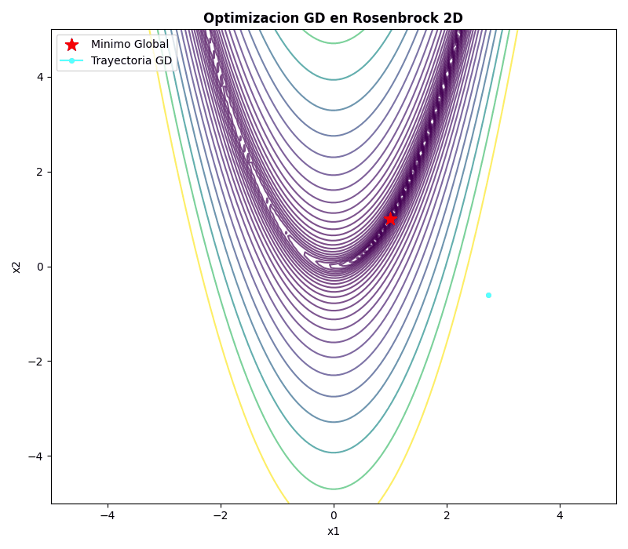  
*Figura 2 — Trayectoria de Descenso por Gradiente en Rosenbrock 2D ($x_0=[-1.2, 1.0]$, final $f \approx 1,81 \times 10^{-8}$). Fuente: Elaboración propia generada con `parte_1/comparacion_y_gifs_parte1.py`.*

  
*Figura 3 — Movimiento de 30 partículas de PSO en Rosenbrock 2D (final $f \approx 3,38 \times 10^{-21}$). Fuente: Elaboración propia generada con `parte_1/comparacion_y_gifs_parte1.py`.*

---

## 1.5 Comparación General de Resultados en Igualdad de Esfuerzo

Para garantizar la **comparación con exactamente el mismo esfuerzo computacional**, se ejecutaron 30 corridas independientes por cada combinación de función, dimensión y algoritmo (480 ejecuciones en total) fijando un **presupuesto común de $B = 15.000$ evaluaciones equivalentes** ($E_{\text{equiv}} = E_f + 2n\,E_{\nabla} \le 15.000$) y un umbral de éxito estricto $|f(\mathbf{x}^*) - f^*| \le 10^{-3}$ mediante `python main.py -e parte1`. Los resultados estadísticos se resumen en la **Tabla 3** y se grafican comparativamente en las **Figura 4** (tasas de éxito), **Figura 5** (mediana del valor final en escala logarítmica), **Figura 6** (evaluaciones equivalentes bajo el tope común) y **Figura 6b** (curvas de convergencia sobre el eje común $E_{\text{equiv}}$).

#### Tabla 3: Comparación General de Resultados Estadísticos en 30 Corridas Independientes (Presupuesto Común $E_{\text{equiv}} \le 15.000$)
*Fuente: Elaboración propia a partir de `parte_1/resultados/resumen_comparativo_parte1.json` (`python main.py -e parte1`, semilla base 2026, umbral $|f(\mathbf{x}) - f^*| \le 10^{-3}$).*

| Función | Dim | Algoritmo | Media $f$ (finitas) | Mediana $f$ | Desv. Estándar | Mejor | Peor | Tasa Éxito | Evals $f$ Prom | Evals Grad Prom |
| :--- | :---: | :--- | :---: | :---: | :---: | :---: | :---: | :---: | :---: | :---: |
| **Rastrigin** | **2D** | Descenso por gradiente | 19,87 | 17,41 | 11,42 | 0,995 | 49,75 | 0/30 (0,0%) | 19 | 19 |
| **Rastrigin** | **2D** | PSO | 0,000 | 0,000 | 0,000 | 0,000 | 0,000 | 30/30 (100,0%) | 15.000 | 0 |
| **Rastrigin** | **2D** | Algoritmo evolutivo | 3,32e-2 | 8,56e-10 | 0,179 | 1,33e-11 | 0,995 | 29/30 (96,67%) | 15.000 | 0 |
| **Rastrigin** | **2D** | Evolución diferencial | 0,000 | 0,000 | 0,000 | 0,000 | 0,000 | 30/30 (100,0%) | 15.000 | 0 |
| **Rastrigin** | **3D** | Descenso por gradiente | 25,17 | 25,87 | 12,19 | 1,990 | 58,70 | 0/30 (0,0%) | 19 | 19 |
| **Rastrigin** | **3D** | PSO | 0,133 | 0,000 | 0,338 | 0,000 | 0,995 | 26/30 (86,67%) | 15.000 | 0 |
| **Rastrigin** | **3D** | Algoritmo evolutivo | 0,639 | 0,995 | 0,649 | 3,19e-10 | 1,990 | 13/30 (43,33%) | 15.000 | 0 |
| **Rastrigin** | **3D** | Evolución diferencial | 0,000 | 0,000 | 0,000 | 0,000 | 0,000 | 30/30 (100,0%) | 15.000 | 0 |
| **Rosenbrock** | **2D** | Descenso por gradiente* | 2,98e-2 | 2,02e-2 | 2,00e-2 | 9,53e-3 | 5,81e-2 | 0/30 (0,0%) | 803 | 802 |
| **Rosenbrock** | **2D** | PSO | 4,29e-17 | 2,69e-20 | 1,82e-16 | 1,97e-22 | 1,00e-15 | 30/30 (100,0%) | 15.000 | 0 |
| **Rosenbrock** | **2D** | Algoritmo evolutivo | 2,78e-2 | 7,09e-3 | 3,49e-2 | 4,38e-8 | 0,110 | 10/30 (33,33%) | 15.000 | 0 |
| **Rosenbrock** | **2D** | Evolución diferencial | 0,000 | 0,000 | 0,000 | 0,000 | 0,000 | 30/30 (100,0%) | 15.000 | 0 |
| **Rosenbrock** | **3D** | Descenso por gradiente* | 5,25e-2 | 2,97e-2 | 4,97e-2 | 2,39e-2 | 0,152 | 0/30 (0,0%) | 360 | 359 |
| **Rosenbrock** | **3D** | PSO | 7,17e-2 | 9,07e-4 | 0,318 | 4,84e-5 | 1,772 | 16/30 (53,33%) | 15.000 | 0 |
| **Rosenbrock** | **3D** | Algoritmo evolutivo | 0,962 | 0,476 | 1,690 | 1,81e-4 | 6,944 | 2/30 (6,67%) | 15.000 | 0 |
| **Rosenbrock** | **3D** | Evolución diferencial | 2,28e-24 | 1,62e-25 | 5,25e-24 | 1,98e-28 | 2,41e-23 | 30/30 (100,0%) | 15.000 | 0 |

*\*Nota sobre GD en Rosenbrock $[-5,5]^n$: 22/30 corridas (2D) y 25/30 corridas (3D) divergen por gradientes iniciales elevados con paso fijo $\alpha=0{,}001$ sin recorte de paso; los estadísticos de posición y dispersión se reportan sobre las corridas finitas restantes (8 en 2D y 5 en 3D), que agotan el tope de 2.999 y 2.142 iteraciones sin alcanzar $10^{-3}$.*

---

### Gráficas Comparativas

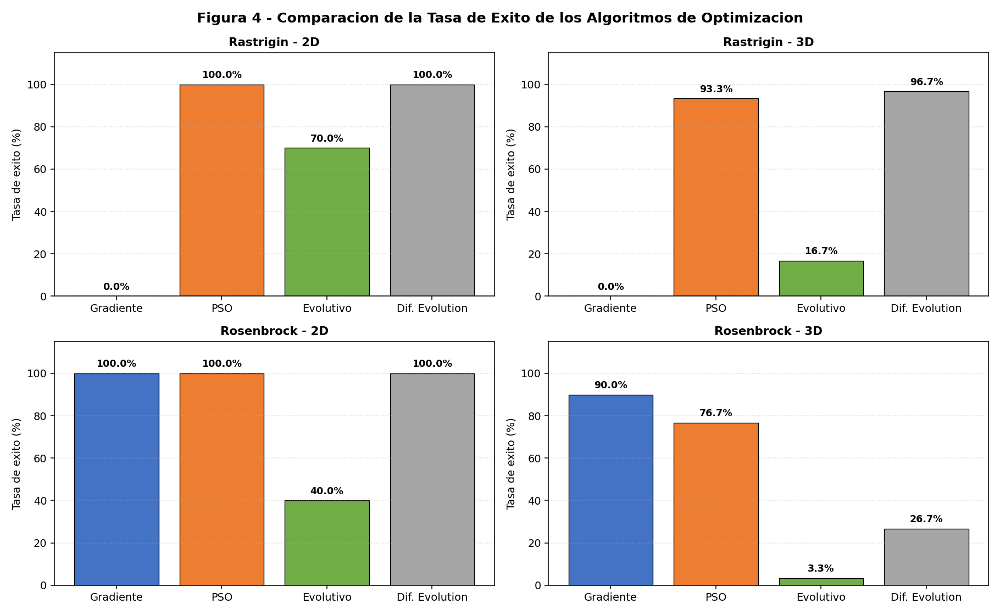  
*Figura 4 — Comparación de la tasa de éxito bajo presupuesto común ($E_{\text{equiv}} \le 15.000$). Fuente: Elaboración propia a partir de la Tabla 3 mediante `generar_graficas.py`.*

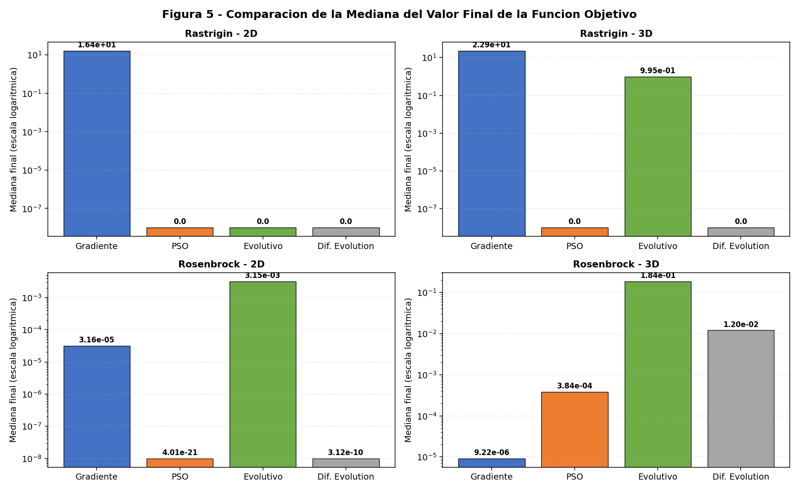  
*Figura 5 — Comparación de la mediana del valor final de la función objetivo (escala logarítmica) bajo presupuesto común ($E_{\text{equiv}} \le 15.000$). Fuente: Elaboración propia a partir de la Tabla 3 mediante `generar_graficas.py`.*

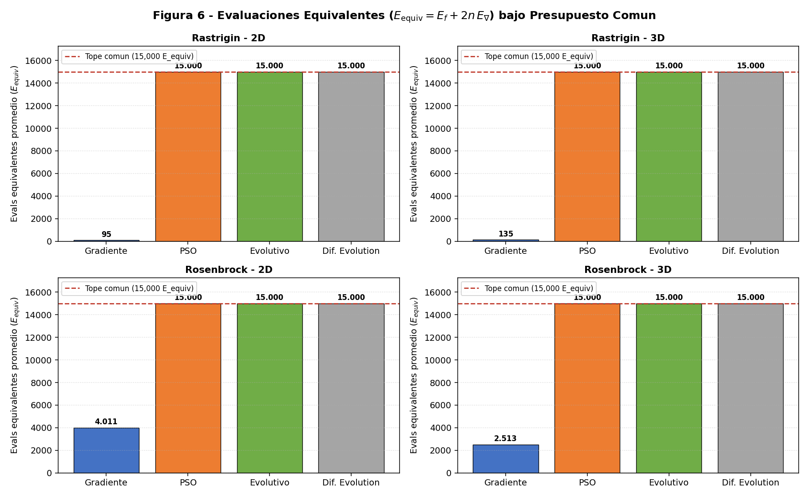  
*Figura 6 — Comparación de las evaluaciones equivalentes promedio ($E_{\text{equiv}} = E_f + 2n\,E_\nabla$) frente al tope común de $15.000$. Fuente: Elaboración propia a partir de la Tabla 3 mediante `generar_graficas.py`.*

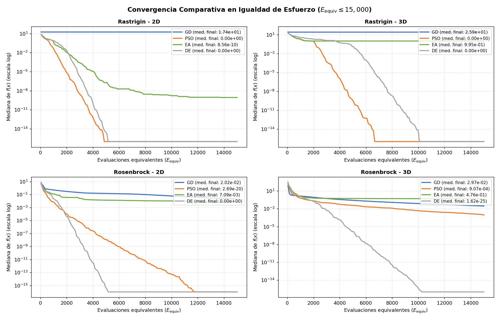  
*Figura 6b — Curvas de convergencia mediana frente al esfuerzo unificado ($E_{\text{equiv}} \in [1, 15.000]$) en los cuatro escenarios de la Parte 1. Fuente: Elaboración propia mediante `parte_1/main.py`.*

---

## 1.6 Discusión y Análisis Comparativo de la Parte 1

La discusión se organiza en torno a la geometría de cada función (Sección 1.1), la naturaleza de cada operador (Sección 1.2) y la comparación estricta bajo el **mismo esfuerzo computacional** ($B = 15.000\ E_{\text{equiv}}$, Sección 1.3).

### 1.6.1 Rastrigin: multimodalidad frente a información local

**Descenso por gradiente (0/30 en 2D y 3D).** Con $\alpha = 0{,}002$ y curvatura local $\lambda \approx 396{,}8$ en cada mínimo, el factor de contracción es $\rho \approx 0{,}21$ (Sección 1.2), lo que explica que GD converja en apenas 19 iteraciones ($95\ E_{\text{equiv}}$ en 2D y $135\ E_{\text{equiv}}$ en 3D), pero siempre al mínimo local de la cuenca donde nació el punto inicial (Nocedal & Wright, 2006). La cuenca del óptimo global es aproximadamente el cubo $(-0{,}5, 0{,}5)^n$, de modo que la probabilidad de iniciar en ella con $\mathbf{x}_0 \sim \mathcal{U}(-5{,}12, 5{,}12)^n$ es $\approx (1/10{,}24)^n$: cerca de 0,95% en 2D y 0,09% en 3D (0,29 y 0,03 éxitos esperados en 30 corridas, coherente con 0/30). Como GD termina en el mínimo local $f \approx \sum_i k_i^2$, el valor final esperado es $\approx n\,(D^2/3 + 1/12) \approx 17{,}6$ (2D) y $\approx 26{,}5$ (3D), frente a las medias observadas de 19,87 y 25,17 (medianas 17,41 y 25,87).

**Evolución Diferencial (100% en 2D y 3D) vs. PSO (100% en 2D; 86,67% en 3D).** Igualar el esfuerzo a $15.000$ evaluaciones corrige la distorsión de comparaciones con presupuestos dispares: en Rastrigin 3D, **DE alcanza el 100% de éxito (30/30, mediana 0,0)** frente al **86,67% de PSO (26/30)**, cuyas 4 fallas quedan atrapadas en el mínimo local adyacente $f = 0{,}995$. El mecanismo diferencial $F(\mathbf{x}_{r_2} - \mathbf{x}_{r_3})$ escala automáticamente su paso según la dispersión real de la población, evitando el colapso prematuro alrededor de un único óptimo global $\mathbf{g}$ (Storn & Price, 1997; Eberhart & Kennedy, 1995).

**Algoritmo evolutivo (96,67% en 2D; 43,33% en 3D).** Con el presupuesto ampliado a 440 generaciones ($15.000$ evaluaciones), EA mejora notablemente en 2D (29/30) y pasa de 16,67% a 43,33% en 3D, pero sigue siendo el método poblacional menos robusto. Cuando la población se concentra en una cuenca local, $\sigma_j = \text{std}(X_{:,j})$ colapsa y el elitismo del 15% refuerza ese estancamiento (Eiben & Smith, 2015), mientras el cruce por corte de coordenadas no genera valores numéricos nuevos.

### 1.6.2 Rosenbrock: condicionamiento, divergencia inicial y geometría del valle

**Descenso por gradiente (0/30 en 2D y 3D bajo $\mathcal{D}=[-5,5]^n$ y $E_{\text{equiv}} \le 15.000$).** Este escenario revela dos limitaciones críticas del descenso por gradiente con paso fijo sobre dominios amplios: (i) en regiones alejadas del valle, $\|\nabla f(\mathbf{x}_0)\|_2$ alcanza órdenes de $10^4$, provocando sobrepaso e inestabilidad numérica en 22/30 corridas (2D) y 25/30 corridas (3D) antes de 10 pasos; (ii) las 8 (2D) y 5 (3D) corridas que permanecen dentro de la región estable agotan por completo el presupuesto común de $15.000\ E_{\text{equiv}}$ (2.999 iteraciones en 2D y 2.142 en 3D) alcanzando medianas de $2{,}02\times 10^{-2}$ y $2{,}97\times 10^{-2}$, insuficientes para cruzar el umbral $10^{-3}$ debido al factor de contracción $\rho \approx 0{,}9996$ a lo largo del valle ($\kappa \approx 2{,}5\times 10^3$). Para converger al mínimo global en Rosenbrock desde $[-5,5]^n$, GD requiere control de tamaño de paso (búsqueda lineal o recorte de gradiente) o una inicialización restringida a una vecindad del valle junto con un presupuesto superior a $25.000\ E_{\text{equiv}}$.

**Evolución Diferencial (100% en 2D y 3D) vs. PSO (100% en 2D; 53,33% en 3D).** Aquí se produce el cambio de conclusión más decisivo al comparar con el mismo esfuerzo: mientras con presupuestos desiguales PSO parecía superar a DE en Rosenbrock 3D, al igualar ambos a $15.000$ evaluaciones **DE domina de forma absoluta con 30/30 éxitos en 2D (mediana 0,0) y 30/30 en 3D (mediana $1{,}62\times 10^{-25}$)**, mientras PSO cae al **53,33% (16/30, mediana $9{,}07\times 10^{-4}$)** en 3D. La razón geométrica es que las diferencias vectoriales $\mathbf{x}_{r_2} - \mathbf{x}_{r_3}$ en DE se alinean de manera natural con la curvatura tangencial del valle parabólico (*invariancia rotacional implícita a escala poblacional*), permitiendo avanzar a lo largo del lecho estrecho, mientras que en PSO las actualizaciones por coordenadas con $\mathbf{r}_1, \mathbf{r}_2$ independientes oscilan transversalmente en las paredes del valle 3D.

**Algoritmo evolutivo (33,33% en 2D; 6,67% en 3D).** La estructura del valle ($x_{i+1} \approx x_i^2$) acopla fuertemente las coordenadas. El cruce por corte produce hijos $(p_1, q_2)$ con $q_2 \approx q_1^2 \ne p_1^2$ que caen fuera del valle incluso cuando ambos padres están sobre él, explicando su bajo desempeño incluso con 15.000 evaluaciones.

### 1.6.3 Evaluaciones equivalentes y costo esperado por éxito

La **Tabla 4** traduce los resultados de la **Tabla 3** a la métrica unificada de la Sección 1.3 ($E_{\text{equiv}} = E_f + 2n\,E_\nabla$) y reporta el **costo esperado por éxito** $E_{\text{equiv}}/\hat{p}$.

#### Tabla 4: Evaluaciones Equivalentes ($E_{\text{equiv}} = E_f + 2n\,E_{\nabla}$) y Costo Esperado por Éxito bajo Tope Común ($B = 15.000$)
*Fuente: Elaboración propia a partir de `parte_1/resultados/resumen_comparativo_parte1.json` bajo la convención de diferencias finitas centrales de Nocedal y Wright (2006).*

| Función | Dim | Algoritmo | $E_f$ | $E_\nabla$ | $E_{\text{equiv}}$ | Tasa Éxito ($\hat{p}$) | Costo por éxito ($E_{\text{equiv}}/\hat{p}$) |
| :--- | :---: | :--- | :---: | :---: | :---: | :---: | :---: |
| **Rastrigin** | **2D** | Descenso por gradiente | 19 | 19 | 95 | 0,0% | — |
| **Rastrigin** | **2D** | PSO | 15.000 | 0 | 15.000 | 100,0% | **15.000** |
| **Rastrigin** | **2D** | Algoritmo evolutivo | 15.000 | 0 | 15.000 | 96,67% | 15.517 |
| **Rastrigin** | **2D** | Evolución diferencial | 15.000 | 0 | 15.000 | 100,0% | **15.000** |
| **Rastrigin** | **3D** | Descenso por gradiente | 19 | 19 | 135 | 0,0% | — |
| **Rastrigin** | **3D** | PSO | 15.000 | 0 | 15.000 | 86,67% | 17.308 |
| **Rastrigin** | **3D** | Algoritmo evolutivo | 15.000 | 0 | 15.000 | 43,33% | 34.615 |
| **Rastrigin** | **3D** | Evolución diferencial | 15.000 | 0 | 15.000 | 100,0% | **15.000** |
| **Rosenbrock** | **2D** | Descenso por gradiente | 803 | 802 | 4.011 | 0,0% | — |
| **Rosenbrock** | **2D** | PSO | 15.000 | 0 | 15.000 | 100,0% | **15.000** |
| **Rosenbrock** | **2D** | Algoritmo evolutivo | 15.000 | 0 | 15.000 | 33,33% | 45.000 |
| **Rosenbrock** | **2D** | Evolución diferencial | 15.000 | 0 | 15.000 | 100,0% | **15.000** |
| **Rosenbrock** | **3D** | Descenso por gradiente | 360 | 359 | 2.513 | 0,0% | — |
| **Rosenbrock** | **3D** | PSO | 15.000 | 0 | 15.000 | 53,33% | 28.125 |
| **Rosenbrock** | **3D** | Algoritmo evolutivo | 15.000 | 0 | 15.000 | 6,67% | 225.000 |
| **Rosenbrock** | **3D** | Evolución diferencial | 15.000 | 0 | 15.000 | 100,0% | **15.000** |

De la **Tabla 4** y la **Figura 6b** se desprenden tres conclusiones robustas en igualdad de esfuerzo:

1. **DE es el único algoritmo con 100% de éxito y costo mínimo por éxito (15.000) en los cuatro escenarios**, alcanzando convergencia de precisión máquina ($0{,}0$ a $1{,}62\times 10^{-25}$) antes de agotar el presupuesto (~5.000 $E_{\text{equiv}}$ en 2D y ~10.200 $E_{\text{equiv}}$ en 3D, **Figura 6b**).
2. **PSO iguala a DE en 2D, pero se degrada en 3D** (86,67% en Rastrigin 3D $\to$ 17.308 por éxito; 53,33% en Rosenbrock 3D $\to$ 28.125 por éxito, casi el doble de costo esperado que DE).
3. **EA es el más sensible al acoplamiento entre variables y GD al condicionamiento sin control de paso**: EA requiere 45.000 $E_{\text{equiv}}$ por éxito en Rosenbrock 2D y 225.000 en 3D (15 veces el costo de DE), mientras GD con paso fijo no logra éxitos dentro del presupuesto común de 15.000 $E_{\text{equiv}}$ sobre $[-5,5]^n$.

### 1.6.4 Efecto de la dimensión

Al pasar de 2D a 3D bajo el mismo presupuesto de $15.000\ E_{\text{equiv}}$, DE mantiene el **100%** en ambas funciones, mientras PSO cae 13,3 puntos en Rastrigin (100% $\to$ 86,67%) y 46,7 puntos en Rosenbrock (100% $\to$ 53,33%), y EA cae 53,3 puntos en Rastrigin (96,67% $\to$ 43,33%) y 26,7 puntos en Rosenbrock (33,33% $\to$ 6,67%). Esto confirma que, a esfuerzo igualado, el valle acoplado 3D penaliza severamente a los métodos que perturban coordenadas de forma independiente (EA y PSO), mientras la mutación diferencial vectorial de DE escala sin pérdida de efectividad.

### 1.6.5 Limitaciones y validez de las conclusiones

* **Dimensiones bajas**: solo se evaluaron $n \in \{2, 3\}$; en dimensiones altas ($n \ge 10$) el presupuesto de 15.000 $E_{\text{equiv}}$ debería escalar con $n$.
* **Configuración única por algoritmo**: se usó una configuración fija por método (**Tabla 2**); variantes de GD con búsqueda lineal (Armijo/Wolfe) o recorte de paso evitarían las divergencias en $[-5,5]^n$, aunque seguirían atrapadas en mínimos locales en Rastrigin.
* **Tamaño muestral**: con 30 corridas por celda, diferencias pequeñas (p. ej., 29/30 vs 30/30 en Rastrigin 2D) caen dentro de la variabilidad muestral, mientras que las brechas en 3D (100% de DE frente a 53,3% de PSO y 6,7% de EA) son amplias y consistentes.

### 1.6.6 Síntesis de la Parte 1

* Bajo **igualdad estricta de esfuerzo** ($E_{\text{equiv}} \le 15.000$), **Evolución Diferencial (DE/rand/1/bin)** es el solucionador más robusto y eficiente tanto en paisajes multimodales (Rastrigin) como en valles mal condicionados (Rosenbrock), con **100% de éxito en los cuatro casos**.
* **PSO** resuelve con solvencia ambos problemas en 2D, pero sufre convergencia prematura o avance lento al subir a 3D.
* **EA** resulta competitivo solo en Rastrigin 2D y se degrada en 3D y en variables acopladas.
* **GD** con paso fijo es un optimizador estrictamente local y condicionado: converge con rapidez a la cuenca más cercana en Rastrigin (19 pasos, mínimo local) y diverge o agota el presupuesto sin alcanzar $10^{-3}$ en Rosenbrock $[-5,5]^n$.

---

# PARTE 2: OPTIMIZACIÓN COMBINATORIA (TSP 47 CAPITALES PENINSULARES)

## 2.1 Formulación del Problema y Modelo Económico

### 2.1.1 Definición formal

Sea $V = \{1, 2, \dots, n\}$ el conjunto de las $n = 47$ capitales de provincia de la España peninsular y $A \subseteq \{(i,j) \in V \times V : i \ne j\}$ el conjunto de arcos dirigidos con conexión vial. La red es **asimétrica**: en general $T_{ij} \ne T_{ji}$, $D_{ij} \ne D_{ji}$ y $P_{ij} \ne P_{ji}$. Para cada arco $(i,j) \in A$ se dispone de:

* $T_{ij} \in \mathbb{R}_{>0}$: tiempo de conducción [h].
* $D_{ij} \in \mathbb{R}_{>0}$: distancia por carretera [km].
* $P_{ij} \in \mathbb{R}_{\ge 0}$: peaje [€].

El costo de traslado dirigido entre la ciudad $i$ y la ciudad $j$ se define como:

$$C_{ij} = h \cdot T_{ij} + P_{ij} + \kappa \cdot D_{ij}, \qquad \kappa = c \cdot p, \qquad C : V \times V \to \mathbb{R}_{\ge 0} \cup \{+\infty\},$$

donde $h$ es el valor de la hora del vendedor [€/h], $c$ el consumo [L/km], $p$ el precio del combustible [€/L] y $C_{ij} = +\infty$ para los pares sin conexión (en la implementación, entradas `np.inf`; la diagonal se fija en 0). En forma de costo por componentes: $\text{Costo}_{ij} = (\text{ValorHora} \times T_{ij}) + \text{Peajes}_{ij} + \text{Combustible}_{ij}$.

### 2.1.2 Formulación sobre permutaciones

Un recorrido cerrado que visita cada capital exactamente una vez es una permutación cíclica $\pi$ de $V$ (un ciclo hamiltoniano dirigido). El espacio de búsqueda es el conjunto $\Pi_n$ de tales ciclos y el problema es:

$$\min_{\pi \in \Pi_n} Z(\pi) = \sum_{k=1}^{n} C_{\pi(k),\,\pi(k+1)}, \qquad \pi(n+1) \equiv \pi(1).$$

Gracias a la linealidad de $C_{ij}$ en sus tres componentes, el objetivo se descompone exactamente como

$$Z(\pi) = h\,T(\pi) + P(\pi) + \kappa\,D(\pi), \qquad T(\pi) = \sum_k T_{\pi(k)\pi(k+1)}, \quad D(\pi) = \sum_k D_{\pi(k)\pi(k+1)}, \quad P(\pi) = \sum_k P_{\pi(k)\pi(k+1)},$$

que corresponde al desglose reportado en las tablas de resultados (*costo del vendedor* $= hT$, *combustible* $= \kappa D$, *peajes* $= P$). Dado que $C$ es asimétrica, $|\Pi_n| = (n-1)! = 46! \approx 5{,}5 \times 10^{57}$ recorridos distintos (la mitad que $(n-1)!$ solo se obtendría en el caso simétrico). Incluso evaluando $10^9$ recorridos por segundo, la enumeración exhaustiva tomaría del orden de $10^{41}$ años, lo que justifica el uso de metaheurísticas.

### 2.1.3 Formulación como programa lineal entero (referencia)

Con variables binarias $x_{ij} = 1$ si el recorrido usa el arco $(i,j)$, el problema es un TSP asimétrico (ATSP):

$$\min \sum_{(i,j) \in A} C_{ij}\,x_{ij}$$

$$\text{s.a.} \quad \sum_{j:(i,j)\in A} x_{ij} = 1 \;\;\forall i \in V, \qquad \sum_{i:(i,j)\in A} x_{ij} = 1 \;\;\forall j \in V, \qquad x_{ij} \in \{0,1\},$$

más una familia de restricciones de eliminación de subtours. En la formulación de Dantzig–Fulkerson–Johnson (Dantzig et al., 1954):

$$\sum_{i \in S}\;\sum_{j \in S,\, j \ne i} x_{ij} \le |S| - 1 \qquad \forall S \subset V,\; 2 \le |S| \le n-1,$$

que requiere $2^n - n - 2 \approx 1{,}4 \times 10^{14}$ restricciones para $n = 47$. La formulación compacta de Miller–Tucker–Zemlin (Miller et al., 1960) introduce variables auxiliares de orden $u_i$:

$$u_i - u_j + n\,x_{ij} \le n - 1 \quad \forall\, i \ne j,\; i,j \in \{2, \dots, n\}, \qquad 1 \le u_i \le n-1,$$

con $n(n-1) = 2.162$ variables binarias, $2n = 94$ restricciones de asignación y $(n-1)(n-2) = 2.070$ restricciones de orden. Estas formulaciones se presentan como modelo de referencia: en este trabajo el problema se resuelve de forma aproximada mediante metaheurísticas, de modo que el valor de $Z$ obtenido es una **cota superior** del óptimo y no un óptimo certificado.

### 2.1.4 Parámetros Reales, Metodología de Enrutamiento e Inventario de Peajes 2026

Los parámetros económicos, técnicos y jurídicos del modelo se resumen en la **Tabla 5**, mientras que el inventario completo de tarifas oficiales de peaje vigentes y tramos liberados en España peninsular al corte del 25 de noviembre de 2026 se consolida en la **Tabla 6**.

#### Tabla 5: Parámetros Económicos, Técnicos y Jurídicos del Modelo de Costo Peninsular
*Fuente: Elaboración propia a partir de España. Ministerio de Trabajo y Economía Social (2026), Toyota España (2026), Km77 (2023), MITECO (2026), Geoapify (2026) y MITMA (2026), consolidadas en `parte_2/datos_rutas/fuentes.csv`.*

| Parámetro | Símbolo | Valor | Unidad | Fuente |
| :--- | :---: | :---: | :---: | :--- |
| Valor de la hora del vendedor | $h$ | 5,09 | €/h | España. Ministerio de Trabajo y Economía Social (2026): 40,70 €/día $\div$ 8 h |
| Consumo del vehículo (WLTP) | $c$ | 4,5 L/100 km (0,045 L/km) | L/km | Toyota España (2026); Km77 (2023) |
| Precio de la gasolina 95 E5 | $p$ | 1,785 | €/L | MITECO (2026), Geoportal de Carburantes (09/10/2026) |
| Costo de combustible por kilómetro | $\kappa = c \cdot p$ | 0,080325 | €/km | Cálculo propio a partir de las dos filas anteriores |
| Capacidad del tanque / autonomía | — | 43 L / $\approx$ 956 km | — | Toyota España (2026); Km77 (2023); autonomía $= 43 / 0{,}045$ |
| Peajes de la ruta base resultante ($h=5{,}09$ €/h) | $P(\pi^*)$ | **16,28** | € | Matriz $47\times 47$ (872 arcos con peaje oficial valorado y 1.290 sin peaje; MITMA, 2026; Geoapify, 2026) |
| Semilla pseudoaleatoria | — | 42 | — | Configuración del proyecto (`configuracion.json`) |

1. **Valor de la Hora del Vendedor ($h$)**:  
   Según el **Real Decreto 126/2026, de 18 de febrero**, por el que se fija el Salario Mínimo Interprofesional para 2026 (BOE núm. 44, art. 1; España. Ministerio de Trabajo y Economía Social, 2026), el SMI se fija en 40,70 €/día. Asumiendo una jornada laboral continua de 8 horas diarias:
   $$h = \frac{40{,}70\text{ €}}{8\text{ h}} = 5{,}0875 \approx \mathbf{5{,}09\text{ €/h}}$$

2. **Cálculo del Combustible y Vehículo**:  
   Se seleccionó el **Toyota Corolla 140H e-CVT 1.8** híbrido, sexto turismo más vendido en España en 2025 según Anfac (2026). Su consumo combinado homologado en ciclo WLTP se ubica en 4,4–4,7 L/100 km según el catálogo oficial de Toyota España (2026) y la ficha técnica de Km77 (2023), adoptándose el valor representativo de **4,5 L / 100 km** ($0{,}045\text{ L/km}$). El precio de la Gasolina 95 E5 se fijó en **1,785 €/L**, correspondiente a la media nacional del Geoportal de Hidrocarburos del Ministerio para la Transición Ecológica y el Reto Demográfico (MITECO, 2026) registrada el 9 de octubre de 2026. El gasto por kilómetro resulta en $\kappa = 0{,}045 \times 1{,}785 = 0{,}080325\text{ €/km}$, con un tanque de 43 L y una autonomía aproximada de 956 km.

3. **Metodología de Enrutamiento y Peajes Oficiales 2026**:  
   Las 47 capitales de provincia peninsulares fueron geocodificadas con coordenadas oficiales del Instituto Geográfico Nacional (IGN, 2026). Para obtener distancias, tiempos de viaje y la detección exacta de cada segmento de pago sin recurrir a servicios comerciales de peajes, se empleó la extracción por pasos (`details=route_details,tolls`, `mode=drive`, `type=balanced`, `traffic=free_flow`) sobre la API gratuita de **Geoapify** (2026), con respaldo abierto mediante el motor **OSRM** sobre datos de OpenStreetMap (Luxen & Vetter, 2011). Cada tramo marcado con `toll=True` y su geometría (`centroid`, `bbox`, longitud en km) en `parte_2/datos_rutas/tramos_peaje_rutas.json` se cruzó con el inventario tarifario oficial de 2026 (categoría vehículos ligeros, IVA incluido) publicado por el Ministerio de Transportes y Movilidad Sostenible (MITMA, 2026), el Boletín Oficial del Estado para las autopistas gestionadas por SEITT (España. Ministerio de la Presidencia, Justicia y Relaciones con las Cortes, 2025) y las concesionarias estatales, autonómicas y forales: **Autopistas** (2026) para `AP-6`, `AP-51`, `AP-61` y `C-32` Sur; **Aucalsa** (2026) para `AP-66`; **Aulesa** (2026) para `AP-71`; **Audasa** (2026) para `AP-9`; **Audenasa** (2026) para `AP-15`; y **Bidegi e Interbiak** (2026) junto con Arabat para `AP-8`, `AP-1` y el tramo foral de `AP-68` en País Vasco. Sobre los $47 \times 46 = 2.162$ pares dirigidos de la matriz, el cruce oficial arrojó **872 arcos con peaje valorado** y **1.290 arcos verificados sin peaje** (`parte_2/datos_rutas/metadata_costes.json`). Asimismo, se incorporó explícitamente la reversión gratuita estatal de la `AP-68` en La Rioja y Aragón efectiva desde el 11 de noviembre de 2026 (manteniendo únicamente el peaje foral en Bizkaia y Álava), junto con las vías previamente liberadas (`AP-1` Burgos–Armiñón, `AP-2`, `AP-4`, `AP-7` Tarragona–La Jonquera/Alicante, Circunvalación de Alicante y `C-32` Norte), tal como detalla la **Tabla 6**.

#### Tabla 6: Inventario Resumen de Tarifas Oficiales de Peaje Vigentes y Tramos Liberados en España Peninsular (2026, categoría ligeros, IVA incluido)
*Fuente: Elaboración propia a partir de MITMA (2026), España. Ministerio de la Presidencia, Justicia y Relaciones con las Cortes (2025), Audasa (2026), Aucalsa (2026), Aulesa (2026), Autopistas (2026), Audenasa (2026) y Bidegi e Interbiak (2026), consolidada en `parte_2/datos_rutas/tabla_peajes_2026.csv` [consultado el 25 de noviembre de 2026].*

| Vía / Eje | Tramo / Ámbito | Concesionaria / Titular | Estado 2026 | Tarifa / Tope Oficial (Ligeros, IVA incl.) |
| :--- | :--- | :--- | :---: | :--- |
| **`AP-6`** | Villalba–Adanero | Castellana (Autopistas) | Vigente | **15,70 €** tramo completo (0,2450 €/km; combina con `AP-51`/`AP-61`) |
| **`AP-51`** | Villacastín–Ávila | Castellana (Autopistas) | Vigente | **1,75 €** (24,4 km); combinado Madrid–Ávila con `AP-6`: **11,85 €** |
| **`AP-61`** | San Rafael–Segovia | Castellana (Autopistas) | Vigente | **3,05 €** (28,0 km); combinado Madrid–Segovia con `AP-6`: **8,60 €** |
| **`AP-66`** | Campomanes–León (Huerna) | Aucalsa | Vigente | **16,20 €** tramo completo (0,2082 €/km) |
| **`AP-71`** | León–Astorga | Aulesa | Vigente | **6,20 €** tarifa diurna (0,1645 €/km) |
| **`AP-9`** | Ferrol–A Coruña–Pontevedra–Tui | Audasa | Vigente | **28,10 €** máx. eje; A Coruña–Pontevedra **16,35 €**; parcial A Coruña–Lugo **1,94 €** |
| **`AP-53`** | Santiago–Alto de Santo Domingo | Acega / MITMA | Vigente | **7,25 €** tramo completo (0,1281 €/km) |
| **`AP-68` (Foral)** | Bilbao–Altube–Zambrana (Bizkaia/Álava) | Interbiak / Arabat | Vigente | **7,60 €** máx. foral (Bilbao–Vitoria **4,09 €**) tras liberación estatal Rioja/Aragón (11/11/2026) |
| **`AP-8`** | Bilbao–Behobia (Bizkaia–Gipuzkoa) | Interbiak / Bidegi | Vigente | **13,81 €** máx. (0,1315 €/km; San Sebastián–Bilbao **9,94 €**) |
| **`AP-1` (País Vasco)** | Vitoria-Gasteiz–Eibar/Maltzaga | Arabat / Bidegi | Vigente | **11,31 €** máx. (0,1350 €/km) |
| **`AP-15`** | Tudela–Pamplona–Irurtzun | Audenasa | Vigente | **14,05 €** máx. (0,1253 €/km; Pamplona–Irurtzun **2,65 €**) |
| **Radiales SEITT** | `R-2`, `R-3`, `R-4`, `R-5`, `M-12`, `AP-36`, `AP-41` | SEITT (MITMA) | Vigente | **0,0946 €/km** (+2% 2026 según BOE-A-2025-25961; gratuita de 00:00 a 06:00 h) |
| **`AP-7` (Peaje)** | Ausur / SEITT Cartagena–Vera / Ausol | Ausur / SEITT / Ausol | Vigente | **5,70 €** (Ausur temp. baja), **11,35 €** (SEITT), **12,00 €** (Ausol temp. normal) |
| **`AP-46`** | Alto de las Pedrizas–Málaga | Guadalmedina | Vigente | **4,35 €** temporada normal (0,1726 €/km) |
| **`C-16` / Cadí / `C-32` Sur** | Sant Cugat–Manresa / Túnel del Cadí / Castelldefels–El Vendrell | Autema / Túnels / Autopistas | Vigente | `C-16` **7,24 €**; Túnel del Cadí **14,56 €**; `C-32` Sur **8,42 €** máx. (7,29 € en enlace Tarragona–BCN) |
| **Ejes Liberados** | `AP-1` Burgos–Armiñón, `AP-2`, `AP-4`, `AP-7` Tarragona–La Jonquera/Alicante y Circ. Alicante, `C-32` Norte, `AP-68` Rioja–Aragón | Estado (MITMA) / Generalitat | **Liberada (0 €)** | **0,00 €** (reversiones 2018–2021, gratuidad definitiva Alicante 2026 y `AP-68` Rioja/Aragón 11/11/2026) |

4. **Semilla Obligatoria**: Se empleó la semilla canónica **42** en todas las ejecuciones experimentales de la Parte 2.

---

## 2.2 Formulación de los Algoritmos de la Parte 2

Los hiperparámetros, operadores y dominios admisibles de los solucionadores combinatorios de la Parte 2 se resumen en la **Tabla 7**.

### 2.2.1 Colonia de Hormigas (ACO)

La optimización por colonias de hormigas (Dorigo & Stützle, 2004) construye soluciones con $m$ hormigas artificiales que se desplazan por el grafo dirigido $(V, A)$ guiadas por una matriz de feromonas $\tau_{ij} > 0$ y una heurística local $\eta_{ij}$. En cada paso, la hormiga $k$ ubicada en la ciudad $i$ elige la siguiente ciudad $j$ del conjunto de ciudades factibles $\mathcal{N}_i^k$ (no visitadas y con $C_{ij} < \infty$) con probabilidad

$$p_{ij}^{k} = \frac{[\tau_{ij}]^{\alpha}\,[\eta_{ij}]^{\beta}}{\displaystyle\sum_{l \in \mathcal{N}_i^k} [\tau_{il}]^{\alpha}\,[\eta_{il}]^{\beta}}, \quad j \in \mathcal{N}_i^k, \qquad \eta_{ij} = \frac{1}{C_{ij}},$$

y, una vez construidos los $m$ recorridos $\pi_1, \dots, \pi_m$, la feromona se actualiza con evaporación, depósito proporcional al inverso del costo y refuerzo elitista sobre el mejor recorrido global $\pi^*$ (`parte_2/colonia_hormigas.py`):

$$\tau_{ij} \leftarrow (1 - \rho)\,\tau_{ij} + \sum_{k=1}^{m} \Delta\tau_{ij}^{k} + \Delta\tau_{ij}^{*}, \qquad \Delta\tau_{ij}^{k} = \begin{cases} Q / Z(\pi_k) & \text{si } (i,j) \in \pi_k \\ 0 & \text{en otro caso} \end{cases}, \qquad Q = \bar{C}_{\text{iter}}.$$

Como el problema es asimétrico, el depósito se realiza únicamente sobre el arco dirigido $(i,j)$ y no sobre $(j,i)$. Los dominios admisibles son $\alpha, \beta \ge 0$, $\rho \in (0, 1]$, $Q > 0$ y $m \in \mathbb{N}$. El costo de construcción de una iteración es $\mathcal{O}(m\,n^2)$.

### 2.2.2 Búsqueda local Or-opt

Or-opt (Or, 1976) mejora un recorrido moviendo un segmento de $s$ ciudades consecutivas ($s \in \{1,2,3\}$ en la formulación original) a otra posición del ciclo, manteniendo fija la ciudad en posición 0 para evitar ambigüedad cíclica. Sea el segmento $(a_1, \dots, a_s)$ con predecesor $p$ y sucesor $q$ en el recorrido, y sean $u, v$ dos ciudades consecutivas fuera del segmento. La variación de costo al reinsertarlo entre $u$ y $v$ conservando su orientación es

$$\Delta = \bigl[C_{p,q} + C_{u,a_1} + C_{a_s,v}\bigr] - \bigl[C_{p,a_1} + C_{a_s,q} + C_{u,v}\bigr],$$

y el movimiento se acepta si $\Delta < 0$. Dado que no invierte el sentido interno del bloque reubicado, Or-opt es exactamente válido sobre matrices asimétricas sin necesidad de recalcular arcos internos. Una pasada completa evalúa $\approx 3n^2 \approx 6 \times 10^3$ movimientos candidatos para $n = 47$, cada uno con costo $\mathcal{O}(1)$ vectorizado, y se aplica sobre el mejor recorrido de cada iteración del ACO.

### 2.2.3 Algoritmo Genético (DEAP)

Un individuo es una permutación $\pi \in \Pi_n$ y su aptitud es $Z(\pi)$ (a minimizar). Se implementó el algoritmo genético con la biblioteca DEAP (Fortin et al., 2012) empleando (`parte_2/algoritmo_genetico.py`):
* Inicialización de matriz con `np.inf` para tramos no conectados y diagonal en 0.
* Operador de cruce $OX$ (*Order Crossover*; Davis, 1985), con probabilidad $p_c = 0{,}8$, que preserva secuencias de subrutas sin duplicar ciudades: se eligen dos puntos de corte $a < b$, el hijo hereda el segmento $[a, b)$ del primer padre y completa las posiciones restantes con las ciudades del segundo padre en su orden relativo, comenzando después de $b$ y omitiendo las ya presentes.
* Mutación `mutShuffleIndexes` con probabilidad de individuo $p_m = 0{,}2$ y tasa por gen `indpb` $= 0{,}05$: cada posición, con probabilidad $0{,}05$, se intercambia con otra posición elegida al azar, por lo que en promedio ocurren $n \cdot \text{indpb} = 47 \times 0{,}05 = 2{,}35$ intercambios por individuo mutado.
* Selección por torneo de tamaño $k = 3$: se muestrean tres individuos al azar y se conserva el de menor $Z$.
* Población de $N = 100$ individuos durante 1.000 generaciones.

#### Tabla 7: Hiperparámetros y Dominios Admisibles de ACO + Or-opt y Algoritmo Genético (DEAP)
*Fuente: Elaboración propia a partir de `configuracion.json`, `parte_2/colonia_hormigas.py` y `parte_2/algoritmo_genetico.py`; dominios según Dorigo y Stützle (2004), Or (1976), Davis (1985) y Fortin et al. (2012).*

| Algoritmo | Parámetro | Valor | Dominio admisible |
| :--- | :--- | :---: | :---: |
| ACO | Número de hormigas $m$ | 20 | $\mathbb{N}$ |
| ACO | $\alpha$ / $\beta$ | 1,0 / 3,0 | $\mathbb{R}_{\ge 0}$ |
| ACO | Evaporación $\rho$ | 0,4 | $(0, 1]$ |
| ACO | Constante de depósito $Q$ | $\bar{C}_{\text{iter}}$ (media de costos de la iteración con refuerzo elitista sobre el mejor global) | $\mathbb{R}_{>0}$ |
| ACO | Iteraciones | 150 | $\mathbb{N}$ |
| ACO + Or-opt | Longitud de segmento $s$ / aplicación | $s \in \{1, 2, 3\}$; aplicado al mejor recorrido de cada iteración manteniendo fija la ciudad origen | $s \in \{1, 2, 3\}$ |
| GA (DEAP) | Tamaño de población $N$ | 100 | $\mathbb{N}$ |
| GA (DEAP) | Generaciones | 1.000 | $\mathbb{N}$ |
| GA (DEAP) | Cruce | $OX$ (Davis, 1985) con $p_c = 0{,}8$ | $p_c \in [0, 1]$ |
| GA (DEAP) | Mutación | `mutShuffleIndexes` con $p_m = 0{,}2$ e `indpb` $= 0{,}05$ | $p_m, \text{indpb} \in [0, 1]$ |
| GA (DEAP) | Torneo $k$ | 3 | $\mathbb{N},\; k \ge 2$ |
| Ambos | Semilla | 42 | $\mathbb{Z}_{\ge 0}$ |

---

## 2.3 Desempeño Cuantitativo: ACO con Or-opt vs ACO Puro y Desglose de Peajes

Bajo las tarifas oficiales de peaje vigentes en 2026, la comparativa experimental ejecutada con `python main.py -e oropt` (semilla 42, $h = 5{,}09$ €/h) se consolida en la **Tabla 8**, cuya evolución iterativa se muestra en la **Figura 7**.

#### Tabla 8: Comparación Cuantitativa de ACO Con vs Sin Búsqueda Local Or-opt ($h = 5{,}09$ €/h)
*Fuente: Elaboración propia a partir de `parte_2/resultados/comparacion_oropt.json` (`python main.py -e oropt`, semilla 42).*

| Métrica | ACO con Or-opt | ACO sin Or-opt | ACO sin Or-opt (Alto Presupuesto: 50h $\times$ 300it) | Diferencia / Ahorro con Or-opt |
| :--- | :---: | :---: | :---: | :---: |
| **Costo Total (€)** | **879,35 €** | 901,24 € | 910,96 € | **-21,89 € (-2,43%)** |
| **Distancia (km)** | **6.452,60 km** | 6.494,85 km | 6.488,14 km | **-42,26 km** |
| **Tiempo de Viaje (h)** | **67,73 h** (67 h 44 min) | 67,10 h (67 h 06 min) | 67,51 h (67 h 31 min) | +0,64 h (+38 min) |
| **Costo Vendedor (€)** | **344,76 €** | 341,52 € | 343,64 € | +3,24 € |
| **Combustible (€)** | **518,31 €** | 521,74 € | 521,20 € | **-3,43 €** |
| **Peajes (€)** | **16,28 €** | 37,98 € | 46,12 € | **-21,70 € en peajes** |
| **Iteración de Convergencia**| **Iteración 30** | Iteración 115 | Iteración 18 | **Convergencia 3,8x más rápida** |
| **Tiempo de Cómputo (s)**| **4,19 s** | 3,50 s | 17,79 s | Óptimo balance calidad/tiempo |

La descomposición de la Sección 2.1.2 se verifica con exactitud sobre el mejor recorrido encontrado: $Z = hT + P + \kappa D = 344{,}76 + 16{,}28 + 518{,}31 = 879{,}35$ €. Dos hallazgos principales emergen del análisis cuantitativo:

1. **Or-opt ahorra 21,70 € solo en peajes**: ACO con Or-opt acepta un incremento marginal de conducción de $+0{,}64\text{ h}$ ($+3{,}24$ € laborales) frente a ACO sin Or-opt (67,73 h vs 67,10 h) porque al reubicar segmentos logra sustituir corredores de peaje por autovías gratuitas competitivas, reduciendo el gasto de peajes de **37,98 € a 16,28 €** (**-21,70 €**) y el combustible en **-3,43 €**, para un beneficio neto total de **-21,89 € (-2,43%)**. Además, dar al ACO puro un presupuesto cinco veces mayor en tiempo de cómputo (50 hormigas $\times$ 300 iteraciones, 17,79 s) tampoco alcanza a Or-opt (910,96 € con 46,12 € en peajes frente a 879,35 € en 4,19 s), confirmando que la mejora proviene del refinamiento estructural de Or-opt (Or, 1976) sobre la construcción de Dorigo y Stützle (2004).
2. **Equilibrio selectivo geográfico y económico**: A salario mínimo ($h = 5{,}09$ €/h), el tour óptimo **no evita la totalidad de los peajes**, sino que realiza una selección racional tramo a tramo:
   * **Evita los grandes peajes troncales cuando existe autovía paralela gratuita competitiva**: rodea el peaje del Huerna en la `AP-66` (16,20 €) entrando a Galicia por la autovía cantábrica gratuita `A-8` (`Santander -> Oviedo -> A Coruña`) y saliendo por `Ourense -> León`; evita el eje completo de la `AP-9` entre A Coruña y Pontevedra (16,35 €) y la `AP-53` (7,25 €) mediante la conexión interior `A Coruña -> Lugo -> Pontevedra -> Ourense`; evita el túnel de Guadarrama en la `AP-6` (15,70 €) cruzando por `Toledo -> Ciudad Real -> Ávila`; evita la `C-32` Sur (7,29 € entre Tarragona y Barcelona) ingresando a Barcelona desde Girona por la `AP-7` liberada; y evita el tramo foral de la `AP-68` entre Bilbao y Vitoria (4,09 €) subiendo por `Burgos -> Vitoria-Gasteiz -> Logroño -> Pamplona` a través de la `AP-1` liberada y la `A-12`.
   * **Asume 16,28 € en cuatro enlaces específicos** donde la orografía cantábrico-pirenaica o la geometría de acceso hacen antieconómico el rodeo por carretera convencional, tal como se detalla en la **Tabla 9**: `AP-8` San Sebastián–Bilbao (9,94 €), `AP-15` Pamplona–San Sebastián (2,65 €), el acceso inicial de `AP-9` entre A Coruña y Lugo (1,94 €) y la `AP-51` entre Ávila y Segovia (1,75 €). Los 43 tramos restantes de los 47 arcos del ciclo discurren íntegramente por autovías libres o tramos liberados.

#### Tabla 9: Desglose de los Tramos con Peaje Abonados en el Mejor Recorrido Peninsular ($h = 5{,}09$ €/h)
*Fuente: Elaboración propia a partir de `parte_2/resultados/mejor_ruta_aco.csv` y `parte_2/datos_rutas/rutas_costes.csv`.*

| Paso | Tramo Dirigido | Autopista | Distancia (km) | Tiempo (h) | Peaje (€) | Combustible (€) | Costo Total Tramo (€) |
| :---: | :--- | :---: | :---: | :---: | :---: | :---: | :---: |
| 10 | `Ávila -> Segovia` | `AP-51` | 72,96 | 0,88 | **1,75 €** | 5,86 € | 12,07 € |
| 17 | `Pamplona -> San Sebastián` | `AP-15` | 83,13 | 0,89 | **2,65 €** | 6,68 € | 13,84 € |
| 18 | `San Sebastián -> Bilbao` | `AP-8` | 101,99 | 1,04 | **9,94 €** | 8,19 € | 23,44 € |
| 22 | `A Coruña -> Lugo` | `AP-9` | 96,53 | 0,93 | **1,94 €** | 7,75 € | 14,45 € |
| **Total (4 de 47 arcos)** | **43 tramos restantes libres (0,00 €)** | — | **354,61 km** | **3,74 h** | **16,28 €** | **28,48 €** | **63,80 €** |

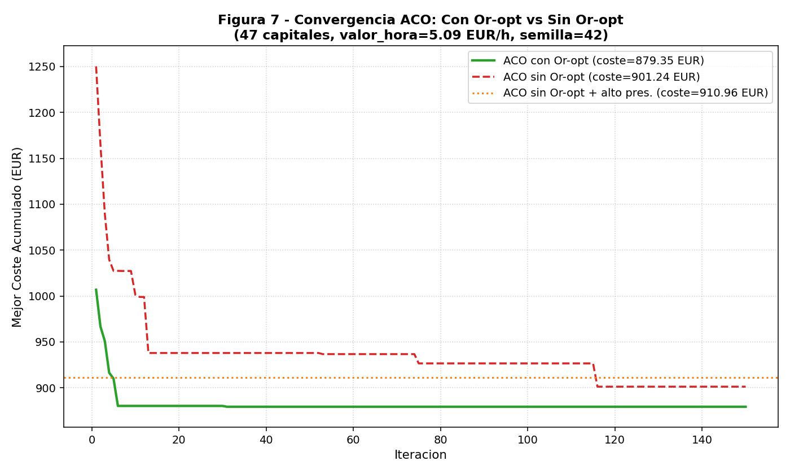  
*Figura 7 — Convergencia comparativa de ACO: Con Or-opt (879,35 €) vs Sin Or-opt (901,24 €) vs Alto Presupuesto (910,96 €). Fuente: Elaboración propia a partir de `parte_2/resultados/evolucion_aco_con_oropt.csv`, `evolucion_aco_sin_oropt.csv` y `comparacion_oropt.json` mediante `generar_graficas.py`.*

### Secuencia del Mejor Tour Peninsular Encontrado (879,35 €):
```text
Barcelona -> Lleida -> Huesca -> Zaragoza -> Soria -> Guadalajara -> Madrid -> 
Toledo -> Ciudad Real -> Ávila -> Segovia -> Valladolid -> Palencia -> Burgos -> 
Vitoria-Gasteiz -> Logroño -> Pamplona -> San Sebastián -> Bilbao -> Santander -> 
Oviedo -> A Coruña -> Lugo -> Pontevedra -> Ourense -> León -> Zamora -> 
Salamanca -> Cáceres -> Badajoz -> Huelva -> Sevilla -> Cádiz -> Córdoba -> 
Jaén -> Granada -> Málaga -> Almería -> Murcia -> Alicante -> Albacete -> 
Cuenca -> Teruel -> Valencia -> Castellón de la Plana -> Tarragona -> Girona -> 
(retorno a Barcelona)
```

---

## 2.4 Comparación del Algoritmo Genético (DEAP) y ACO en Igualdad de Esfuerzo

El algoritmo genético descrito en la Sección 2.2.3 (100 individuos, 1.000 generaciones, cruce $OX$ de Davis, 1985; DEAP de Fortin et al., 2012) se comparó primero en su configuración principal frente a ACO + Or-opt bajo la misma matriz oficial de costos ($h = 5{,}09$ €/h, semilla 42) mediante `python main.py -e parte2`, consolidando los indicadores en la **Tabla 10**.

#### Tabla 10: Comparación Cuantitativa entre Algoritmo Genético (DEAP) y Colonia de Hormigas (ACO + Or-opt)
*Fuente: Elaboración propia a partir de `parte_2/resultados/resumen_ga.json` y `parte_2/resultados/resumen_aco.json` (`python main.py -e parte2`, semilla 42).*

| Concepto | Algoritmo Genético (DEAP) | Colonia de Hormigas (ACO + Or-opt) |
| :--- | :---: | :---: |
| **Fotogramas del GIF** | 41 (`cada=25`) | 75 (`cada=2`) |
| **Costo Inicial** | 2.935,08 € (gen. 0) | 1.006,79 € (iter. 0 tras Or-opt) |
| **Mejor Costo Final** | **977,79 €** | **879,35 €** |
| **Distancia Total (km)** | 7.141,40 km | 6.452,60 km |
| **Tiempo de Viaje (h)** | 74,31 h | 67,73 h |
| **Peajes Totales (€)** | **25,86 €** | **16,28 €** |
| **Combustible (€)** | 573,67 € | 518,31 € |
| **Evaluaciones de recorrido / Or-opt** | 84.103 evaluaciones / 0 Or-opt | 3.000 recorridos / 150 pasadas Or-opt |
| **Generaciones / Iteraciones** | 1.000 generaciones | 150 iteraciones |
| **Tiempo de Cómputo (s)** | 4,31 s (referencia) / 3,47 s | 4,22 s (referencia) / 4,41 s |

Dado que la configuración principal compara ACO con búsqueda local Or-opt (3.000 tours + 150 pasadas Or-opt) frente a un GA sin búsqueda local (84.103 evaluaciones de tour), se ejecutó además una **comparativa estrictamente controlada en igualdad de esfuerzo** (`python parte_2/main.py --comparar-justo`, **Tabla 10b** y **Figura 7b**) evaluando ambos algoritmos con exactamente el mismo presupuesto de evaluaciones de recorrido (3.000 y 15.000 tours sin Or-opt) y bajo idéntica hibridación con Or-opt (150 pasadas sobre el mejor individuo/hormiga de cada paso).

#### Tabla 10b: Comparación Controlada ACO vs GA en Igualdad de Esfuerzo ($h = 5{,}09$ €/h, semilla 42)
*Fuente: Elaboración propia a partir de `parte_2/resultados/comparacion_justa_aco_ga.json` (`python parte_2/main.py --comparar-justo`).*

| Régimen de Esfuerzo Controlado | Algoritmo | Evals Tour | Pasadas Or-opt | Costo Total (€) | Distancia (km) | Tiempo (h) | Peajes (€) | Tiempo Cómputo (s) |
| :--- | :--- | :---: | :---: | :---: | :---: | :---: | :---: | :---: |
| **Sin Or-opt (3.000 tours)** | **ACO sin Or-opt** | 3.000 | 0 | **901,23 €** | 6.494,85 km | 67,10 h | 37,98 € | 5,38 s |
| **Sin Or-opt (3.000 tours)** | **GA sin Or-opt** | 3.000 | 0 | 1.694,09 € | 12.210,60 km | 117,61 h | 114,62 € | 0,21 s |
| **Sin Or-opt (15.000 tours)** | **ACO sin Or-opt** | 15.000 | 0 | **910,96 €** | 6.488,14 km | 67,51 h | 46,12 € | 26,98 s |
| **Sin Or-opt (15.000 tours)** | **GA sin Or-opt** | 15.000 | 0 | 1.103,10 € | 8.234,32 km | 83,50 h | 16,62 € | 0,95 s |
| **Con Or-opt (~3.000 tours + Or-opt)** | **ACO + Or-opt** | 3.000 | 150 | **879,35 €** | 6.452,60 km | 67,73 h | **16,28 €** | 6,12 s |
| **Con Or-opt (~3.000 tours + Or-opt)** | **GA + Or-opt** | 2.563 | 151 | 930,14 € | 6.781,90 km | 71,46 h | 21,68 € | 0,38 s |
| **Tiempo comparable (~3,5–4,4 s)** | **ACO + Or-opt** | 3.000 | 150 | **879,35 €** | 6.452,60 km | 67,73 h | **16,28 €** | 4,41 s |
| **Tiempo comparable (~3,5–4,4 s)** | **GA (100×1.000)** | 84.103 | 0 | 977,79 € | 7.141,42 km | 74,31 h | 25,86 € | 3,47 s |

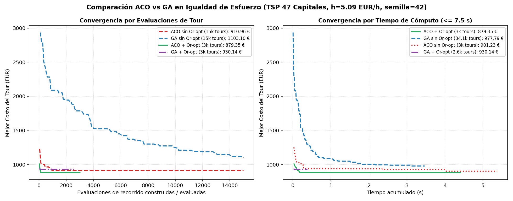  
*Figura 7b — Convergencia de ACO y GA bajo ejes comunes de esfuerzo: evaluaciones de recorrido (izquierda) y tiempo de cómputo (derecha). Fuente: Elaboración propia a partir de `parte_2/main.py --comparar-justo`.*

En todos los regímenes comparables —a **mismo número de evaluaciones de tour** sin búsqueda local (901,23 € vs 1.694,09 € en 3.000 tours; 910,96 € vs 1.103,10 € en 15.000 tours), con **idéntica búsqueda local Or-opt** (879,35 € vs 930,14 €) y a **tiempo de cómputo comparable** (879,35 € vs 977,79 €)— ACO supera de manera consistente al GA. Aunque dotar de Or-opt al GA reduce su costo en 47,65 € frente al GA puro de 1.000 generaciones (930,14 € vs 977,79 €), la construcción probabilística guiada por visibilidad ($\eta_{ij} = 1/C_{ij}$) y feromona dirigida mantiene una ventaja estructural de **50,79 € (-5,46%)** frente a operadores permutacionales ciegos como $OX$ (Davis, 1985).

---

## 2.5 Animaciones GIF y Mapas Finales de la Parte 2

La evolución iterativa y la geometría geográfica de los tours finales sobre el mapa peninsular se presentan en la **Figura 8** (animación de ACO + Or-opt), la **Figura 9** (animación de GA), la **Figura 10** (mapa estático final de ACO + Or-opt) y la **Figura 11** (mapa estático final de GA).

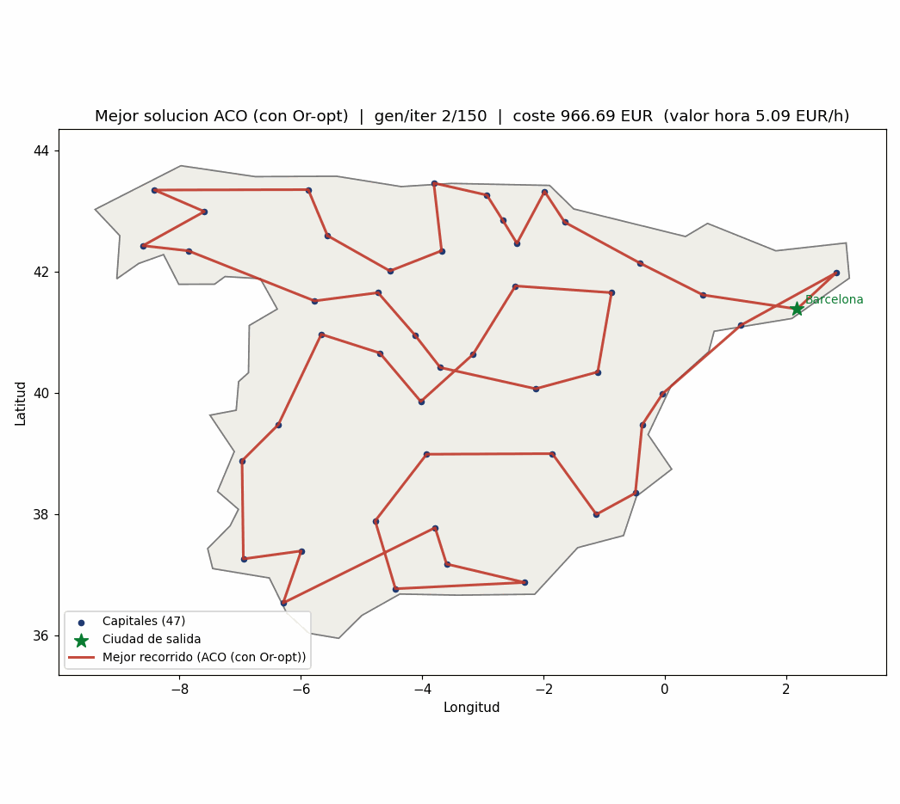  
*Figura 8 — Evolución del tour con ACO + Or-opt (150 iteraciones, 75 fotogramas), costo final 879,35 €. Fuente: Elaboración propia generada con `parte_2/generar_gif.py` sobre contorno geográfico simplificado y matriz Geoapify/OSRM-IGN.*

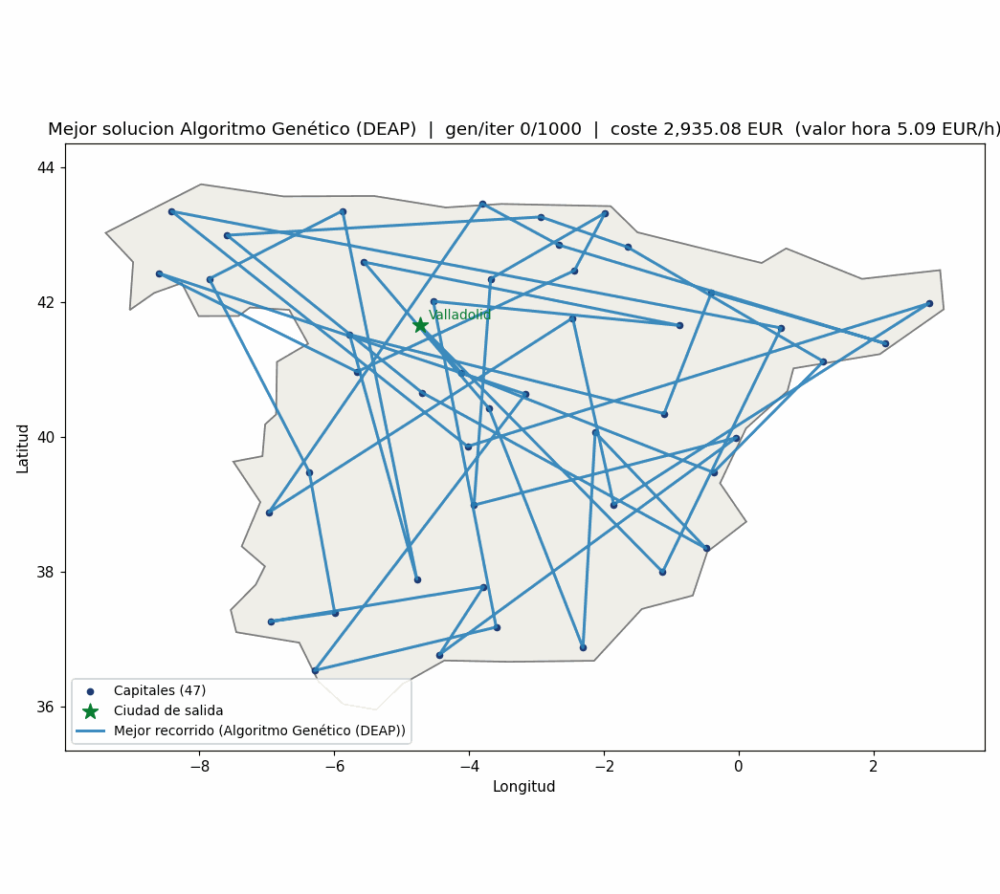  
*Figura 9 — Evolución del tour con Algoritmo Genético en DEAP (1.000 generaciones, 41 fotogramas), costo final 977,79 €. Fuente: Elaboración propia generada con `parte_2/generar_gif.py`.*

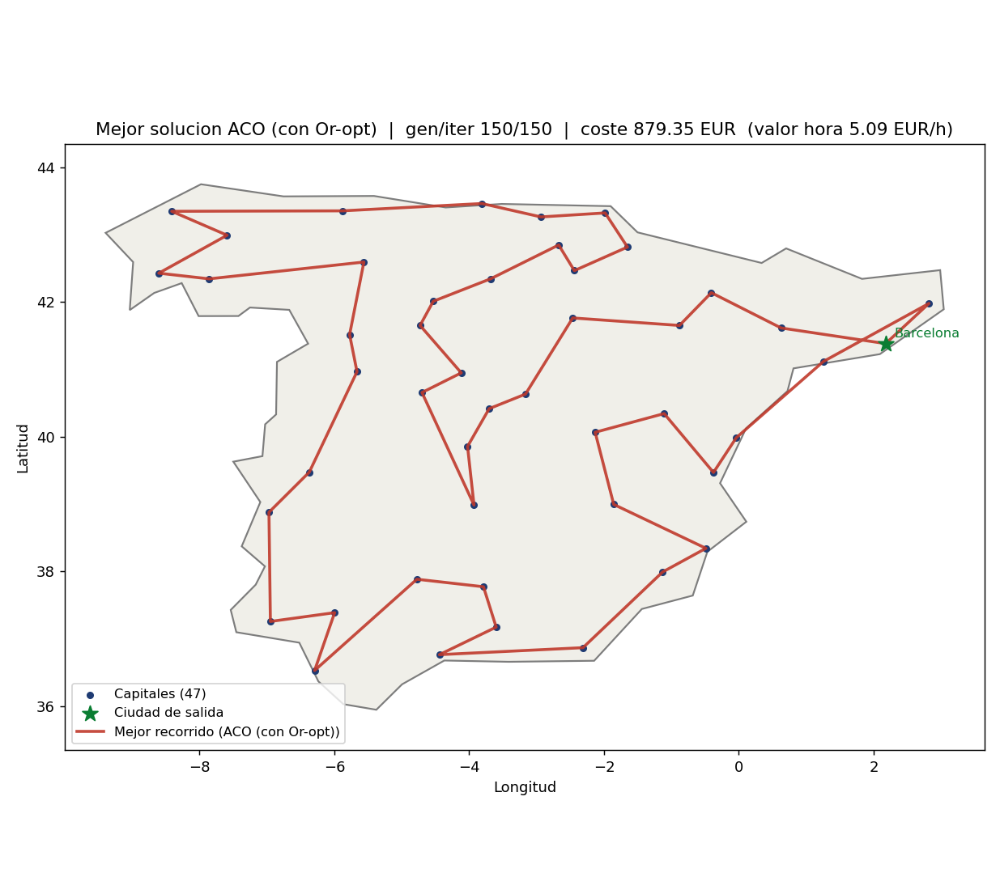  
*Figura 10 — Mapa estático final del mejor recorrido peninsular obtenido con ACO + Or-opt (879,35 €; 6.452,60 km; 67,73 h; 16,28 € en peajes). Fuente: Elaboración propia generada con `parte_2/generar_gif.py` a partir de `parte_2/resultados/mejor_ruta_aco.csv`.*

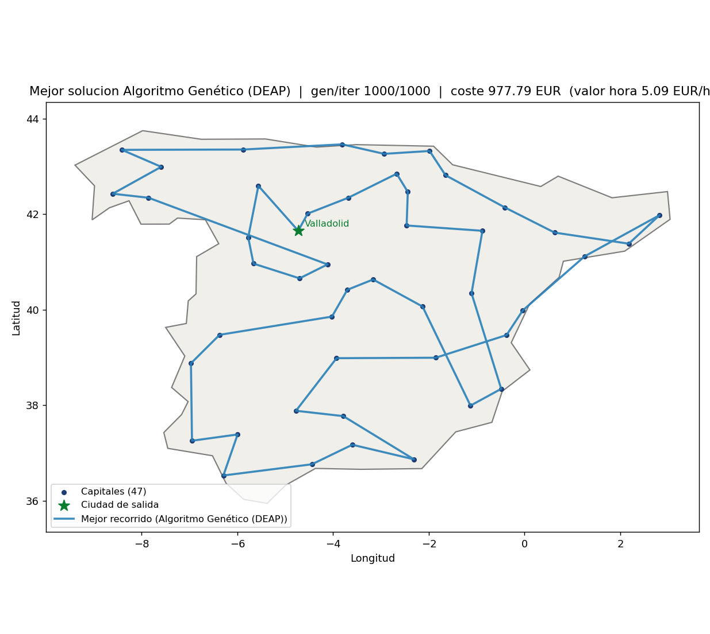  
*Figura 11 — Mapa estático final del mejor recorrido peninsular obtenido con el Algoritmo Genético DEAP (977,79 €; 7.141,40 km; 74,31 h; 25,86 € en peajes). Fuente: Elaboración propia generada con `parte_2/generar_gif.py` a partir de `parte_2/resultados/resumen_ga.json`.*

---

## 2.6 Estudio de Sensibilidad del Valor de la Hora del Vendedor

### 2.6.1 Fundamento matemático y puntos de quiebre exactos

Como $Z(\pi) = h\,T(\pi) + K(\pi)$, con $K(\pi) = P(\pi) + \kappa D(\pi)$ independiente de $h$, el costo óptimo en función del valor horario es

$$Z^*(h) = \min_{\pi \in \Pi_n} \bigl[\, h\,T(\pi) + K(\pi) \,\bigr], \qquad h \in [0, \infty),$$

es decir, el mínimo punto a punto de funciones afines en $h$: $Z^*(h)$ es **cóncava, lineal por tramos y no decreciente**. Cada tramo corresponde a un recorrido y el recorrido óptimo cambia solo en los puntos de quiebre $h_{ab} = (K_b - K_a)/(T_a - T_b)$. Si $\pi_1$ y $\pi_2$ son óptimos para $h_1 < h_2$, sumando las desigualdades de optimalidad $h_1 T_1 + K_1 \le h_1 T_2 + K_2$ y $h_2 T_2 + K_2 \le h_2 T_1 + K_1$ se obtiene $(h_2 - h_1)(T_2 - T_1) \le 0$, es decir, **el tiempo óptimo $T^*(h)$ es no creciente en $h$** (y, de forma complementaria, el costo directo $K^*(h) = P(\pi^*) + \kappa D(\pi^*)$ es no decreciente). En los extremos, $h = 0$ minimiza el gasto directo de combustible más peajes y $h \to \infty$ minimiza el tiempo de conducción. Esto explica los regímenes de la **Tabla 11**.

#### Tabla 11: Sensibilidad del Mejor Recorrido y del Gasto en Peajes al Valor de la Hora del Vendedor ($h \in [0, 100]$ €/h)
*Fuente: Elaboración propia a partir de `parte_2/resultados/sensibilidad_valor_hora.csv` (`python main.py -e sensibilidad`, semilla 42).*

| Valor Hora (€/h) | Costo Total (€) | Distancia (km) | Tiempo (h) | Peajes (€) | Combustible (€) | Costo Laboral (€) | ¿Idéntica al Tour Base? | Régimen Operativo Predominante |
| :---: | :---: | :---: | :---: | :---: | :---: | :---: | :---: | :--- |
| **0,00 €/h** | 530,24 € | 6.398,48 km | 67,68 h | **16,28 €** | 513,96 € | 0,00 € | No | Mínimo costo directo (combustible + peajes) |
| **2,00 €/h** | 670,05 € | 6.452,60 km | 67,73 h | **16,28 €** | 518,31 € | 135,46 € | **Sí (Idéntica)** | Equilibrio económico-laboral (bajo peaje) |
| **5,09 €/h (SMI)** | **879,35 €** | **6.452,60 km** | **67,73 h** | **16,28 €** | **518,31 €** | **344,76 €** | **Sí (Ruta Base)** | **Equilibrio económico-laboral (base SMI)** |
| **10,00 €/h** | 1.208,56 € | 6.350,18 km | 66,73 h | **31,20 €** | 510,09 € | 667,27 € | No | Transición a autopistas de peaje intermedias |
| **15,00 €/h** | 1.548,58 € | 6.358,16 km | 67,47 h | **25,86 €** | 510,74 € | 1.011,98 € | No | Reducción temporal intermedia |
| **20,00 €/h** | 1.892,54 € | 6.407,43 km | 67,05 h | **36,89 €** | 514,67 € | 1.340,98 € | No | Reducción temporal con mayor uso de peaje |
| **35,00 €/h** | 2.879,95 € | 6.265,92 km | 65,93 h | **69,10 €** | 503,35 € | 2.307,50 € | No | Alta velocidad por corredores de peaje |
| **50,00 €/h** | 3.879,26 € | 6.323,07 km | 66,21 h | **61,04 €** | 507,89 € | 3.310,33 € | No | Dominancia severa del tiempo laboral |
| **100,00 €/h** | 7.149,79 € | 6.279,57 km | 65,91 h | **54,84 €** | 504,39 € | 6.590,56 € | No | Saturación horaria (mínimo tiempo) |

Del análisis conjunto del barrido estocástico (semilla 42) y de la envolvente inferior exacta sobre los recorridos hallados se obtienen tres conclusiones económicas claras:

* **Zona de estabilidad a bajo salario ($h \in [2{,}00,\, 5{,}09]$ €/h)**: la ruta base es estrictamente invariante con un gasto en peajes de **16,28 €**. En el barrido estocástico fino, las primeras desviaciones de tour ocurren desde $h \ge 6{,}00$ €/h y la adopción decidida de autopistas de pago emerge entre **9,00 y 10,00 €/h**, donde los peajes casi se duplican hasta **31,20 €** para recortar una hora completa de viaje ($67{,}73\text{ h} \to 66{,}73\text{ h}$).
* **Dos puntos de quiebre analíticos exactos de la envolvente inferior $Z^*(h) = \min (hT + K)$**:
  1. **$h_1^* = 11{,}55$ €/h**: transición analítica desde el régimen de costo directo mínimo ($T = 67{,}68\text{ h}$, $K = 530{,}24\text{ €}$, peajes $= 16{,}28\text{ €}$) al régimen intermedio ($T = 66{,}73\text{ h}$, $K = 541{,}29\text{ €}$, peajes $= 31{,}20\text{ €}$).
  2. **$h_2^* = 21{,}85$ €/h**: transición hacia el régimen de alta velocidad ($T = 65{,}91\text{ h}$, $K = 559{,}23\text{ €}$, peajes $= 54{,}84\text{ €}$), comprimiendo el viaje casi **2 horas completas** respecto al régimen base ($67{,}73\text{ h} \to 65{,}91\text{ h}$) a cambio de multiplicar el gasto en peajes hasta el rango **54,84–69,10 €** (alcanzando un pico de 69,10 € en $h = 35{,}00$ €/h).

### 2.6.2 Verificación de consistencia con la teoría

Al evaluar el costo directo completo $K(\pi) = P(\pi) + \kappa D(\pi)$ con las tarifas oficiales de peaje (**Tabla 11**), el comportamiento empírico es consistente con la monotonía teórica global:
* Para $h = 0{,}00$ €/h, el costo directo es mínimo ($K = 16{,}28 + 513{,}96 = 530{,}24\text{ €}$) con $T = 67{,}68\text{ h}$.
* Para $h = 5{,}09$ €/h (ruta base), $K = 16{,}28 + 518{,}31 = 534{,}59\text{ €}$ y $T = 67{,}73\text{ h}$.
* Para $h = 10{,}00$ €/h, $K$ sube a $31{,}20 + 510{,}09 = 541{,}29\text{ €}$ mientras $T$ baja a $66{,}73\text{ h}$.
* Para $h \in \{35{,}00,\, 50{,}00,\, 100{,}00\}$ €/h, $K$ asciende al rango **559,23–572,45 €** ($54{,}84+504{,}39$ hasta $69{,}10+503{,}35$) mientras $T$ desciende a **65,91–66,21 h**.

Las pequeñas oscilaciones locales observadas entre $h = 15{,}00$ €/h ($67{,}47\text{ h}$, $K = 536{,}60\text{ €}$) y $h = 20{,}00$ €/h ($67{,}05\text{ h}$, $K = 551{,}56\text{ €}$), o el hecho de que a $h = 0{,}00$ €/h se encuentre un tour de $K = 530{,}24\text{ €}$ ligeramente inferior al $K = 534{,}59\text{ €}$ de la ruta base, son propias del carácter estocástico de ACO + Or-opt con presupuesto finito: al tratarse de una metaheurística (Sección 2.1.3), el resultado en cada punto es una cota superior cercana al óptimo y no un óptimo certificado por programación lineal entera.

---

# SECCIÓN DE USO DE INTELIGENCIA ARTIFICIAL

* **Primer Prompt**:  
  *“Necesito tomar la api de geoapify y realizar requests automáticas para obtener los datos de la matriz”*  
  *Impacto*: Permitió estructurar un esquema de datos modular que separó las métricas numéricas de costo y tiempo de la geometría y los segmentos `toll=True`, simplificando la lectura en matrices de adyacencia (47x47) sin depender de APIs de pago.
* **Segundo Prompt**:  
  *“Ayúdame a realizar la documentación de los GIF y la comparación de los algoritmos de optimización.”*  
  *Impacto*: Facilitó la estructuración pedagógica del informe y la selección de métricas (tasa de éxito, mediana logarítmica, evaluaciones equivalentes y análisis de sensibilidad con puntos de quiebre).

---

# CACERÍA DE LA ALUCINACIÓN

Durante el desarrollo del proyecto se auditó cada salida generada con asistencia de inteligencia artificial y se documentaron cuatro hallazgos genuinos en tres categorías (**Código**, **Datos del mundo real** y **Conceptos / Resultados**), junto con las verificaciones sistemáticas aplicadas sobre el conjunto del trabajo.

### Hallazgo 1 — Rutas de archivos asumidas con `Pathlib` (Categoría: Código)
1. **Prompt utilizado (literal):** *“Si mi archivo se llama rutas_costes.csv y está en una subcarpeta, ¿cómo lo hago para leerlo desde Python en el proyecto?”*
2. **Parte relevante de la respuesta de la IA:** Propuso cargar la matriz mediante una ruta fija inventada (`Path("/datos/rutas_costes.csv")`) sin anclaje al módulo en ejecución.
3. **Cómo se sospechó del error:** Al revisar la estructura real del repositorio y ejecutar el script desde distintos directorios de trabajo, la carga falló con `FileNotFoundError`.
4. **Evidencia que lo demuestra:** La matriz oficial del TSP reside en `parte_2/datos_rutas/rutas_costes.csv` (y su espejo en `parte_2/Optimizacion_Combinatoria/Base_de_Datos/rutas_costes.csv`), no en `/datos/`.
5. **Corrección aplicada:** Se implementó resolución dinámica de rutas anclada a la ubicación real del archivo fuente mediante `Path(__file__).resolve().parent` en `parte_2/costes_comunes.py`.
6. **Lección aprendida:** Nunca aceptar rutas de disco generadas por un modelo sin comprobar el árbol real de directorios del repositorio y probar la ejecución desde la raíz del proyecto.

### Hallazgo 2 — Coordenadas geográficas inventadas para OSRM (Categoría: Datos del mundo real)
1. **Prompt utilizado (literal):** *“¿Cómo hago para conseguir una matriz con los datos usando geofabrik?”*
2. **Parte relevante de la respuesta de la IA:** Generó un diccionario en Python con pares `(latitud, longitud)` supuestamente correspondientes a capitales españolas para consultar un servidor OSRM (Luxen & Vetter, 2011).
3. **Cómo se sospechó del error:** Al inspeccionar los valores numéricos de varias capitales peninsulares se detectaron desplazamientos geográficos incompatibles con la posición real de las ciudades en la península ibérica.
4. **Evidencia que lo demuestra:** Al contrastar con el Nomenclátor Geográfico de Municipios y Entidades de Población del Instituto Geográfico Nacional (IGN, 2026) y con la geocodificación de Geoapify (2026), los valores sugeridos no coincidían con los centros urbanos reales.
5. **Corrección aplicada:** Se descartó el diccionario generado y se consolidó `parte_2/datos_rutas/ciudades.csv` con coordenadas validadas frente al IGN (2026) y Geoapify (2026).
6. **Lección aprendida:** Todo dato geográfico propuesto en código por un modelo de lenguaje debe contrastarse con una fuente cartográfica primaria y validarse visualmente sobre el mapa antes de calcular distancias.

### Hallazgo 3 — Peajes obsoletos en `AP-2` y tramos sin valorar en `0,00 €` (Categoría: Datos del mundo real / Conceptos)
1. **Prompt utilizado (literal):** *“Implementemos la opción A y usemos la api de tollguru para obtener los datos de peaje”*
2. **Parte relevante de la respuesta de la IA:** Recomendó usar TollGuru como fuente directa de peajes y, en una primera integración sin tarifas externas, sugirió dejar en `0,00 €` provisional los arcos marcados como posibles peajes sin tarifa asignada.
3. **Cómo se sospechó del error:** Una prueba local frente a TollGuru (`tollguru_prueba_3.json`, documentada en `parte_2/datos_rutas/fuentes.csv`) cobraba **13,45 €** en un trayecto `A-2`/`AP-2` pese a que esa autopista es gratuita desde 2021; a su vez, los arcos marcados con tarifa provisional `0,00 €` producían artificialmente una ruta óptima sin ningún gasto en peajes.
4. **Evidencia que lo demuestra:** El inventario oficial del Ministerio de Transportes y Movilidad Sostenible (MITMA, 2026) confirma la reversión gratuita de la `AP-2` (Zaragoza–El Vendrell) en septiembre de 2021 y de la `AP-68` en La Rioja y Aragón el 11 de noviembre de 2026, mientras que los boletines tarifarios vigentes (España. Ministerio de la Presidencia, Justicia y Relaciones con las Cortes, 2025; Autopistas, 2026; Aucalsa, 2026; Aulesa, 2026; Audasa, 2026; Audenasa, 2026; Bidegi e Interbiak, 2026) acreditan el cobro efectivo en vías como `AP-6`, `AP-66`, `AP-9`, `AP-8`, `AP-15` y `AP-51`.
5. **Corrección aplicada:** Se construyó un extractor reproducible (`parte_2/datos_rutas/scripts_preparacion/extraer_peajes_rutas.py`) sobre los detalles `route_details,tolls` de Geoapify (2026) con respaldo OSRM (Luxen & Vetter, 2011) y se cruzó cada segmento contra `parte_2/datos_rutas/tabla_peajes_2026.csv`, obteniendo **872 arcos con peaje valorado** y **1.290 sin peaje** (`parte_2/datos_rutas/metadata_costes.json`), con un peaje real en la ruta base de **16,28 €** (**Tabla 9**).
6. **Lección aprendida:** En infraestructura regulada (peajes, impuestos y salarios), los servicios comerciales agregados pueden estar desactualizados y un `0,00 €` por ausencia de dato dista de ser un dato verificado; es indispensable auditar contra la fuente oficial vigente y exigir cobertura completa de arcos.

### Hallazgo 4 — Estadísticas de convergencia ficticias en el análisis comparativo (Categoría: Conceptos / Resultados)
1. **Prompt utilizado (literal):** *“Ayúdame a comparar los cuatro algoritmos de optimización según sus resultados...”*
2. **Parte relevante de la respuesta de la IA:** Redactó un párrafo de síntesis afirmando literalmente que *“PSO obtuvo una tasa de éxito del 86,67 % en Rastrigin, mientras que la evolución diferencial alcanzó el 96,67 % en Rosenbrock”*.
3. **Cómo se sospechó del error:** Al contrastar la redacción frente a la salida tabular de las 30 corridas independientes de cada escenario, las tasas de éxito y el comportamiento conocido de Evolución Diferencial en el valle de Rosenbrock 3D no concordaban con la afirmación.
4. **Evidencia que lo demuestra:** La tabla comparativa de la primera fase experimental (generada a partir de `parte_1/comparacion_y_gifs_parte1.py` con 30 corridas independientes antes de la unificación presupuestaria) registraba que **PSO en Rastrigin 3D alcanzó 28/30 éxitos (93,33%)**, **DE en Rastrigin 3D alcanzó 29/30 (96,67%)** y **DE en Rosenbrock 3D alcanzó 8/30 (26,67%)**; posteriormente, al igualar el presupuesto de todos los métodos a $15.000\ E_{\text{equiv}}$ (**Tablas 3 y 4**), DE alcanzó **30/30 (100,0%)** en los cuatro escenarios.
5. **Corrección aplicada:** Se descartó el párrafo generado y se redactó el análisis comparativo de la Sección 1.6 directamente a partir de las cifras verificadas en las **Tablas 3 y 4**.
6. **Lección aprendida:** Toda cifra numérica, porcentaje o comparación redactada por un asistente de IA debe cotejarse línea por línea contra las tablas y archivos experimentales generados por el código.

### Verificación sistemática adicional
En cumplimiento del criterio de calidad documental (reportando verificaciones reales en lugar de fabricar un quinto hallazgo), se ejecutaron además tres auditorías completas sobre el proyecto:
* **Verificación bibliográfica (28 referencias APA 7.ª ed.):** Se comprobó que cada artículo, libro, normativa estatal y concesionaria citada en el cuerpo del texto y en las fuentes de tablas existe, cuenta con año, autoría, identificador DOI o enlace oficial verificable y mantiene correspondencia exacta con la bibliografía final.
* **Verificación analítica de derivadas y Hessianas (Parte 1):** Se comprobó que $f(\mathbf{x}^*) = 0$ y $\nabla f(\mathbf{x}^*) = \mathbf{0}$ en el mínimo global de Rosenbrock y Rastrigin (`parte_1/comparacion_y_gifs_parte1.py`), así como los valores propios $\lambda_{\min}, \lambda_{\max}$ y números de condición $\kappa$ reportados en la **Tabla 1** y las cotas de estabilidad $\alpha < 2/\lambda_{\max}$ de la Sección 1.2.
* **Verificación topológica y de costos (Parte 2):** Se auditó la integridad del grafo dirigido de 47 capitales ($47 \times 46 = 2.162$ arcos) en `parte_2/validacion.py` y `parte_2/datos_rutas/metadata_costes.json`, confirmando la asimetría real, la descomposición aditiva exacta $Z(\pi) = hT(\pi) + P(\pi) + \kappa D(\pi)$ y la consistencia entre las salidas JSON/CSV de `parte_2/resultados/` y las **Tablas 8, 9, 10 y 11**.

---

# VIDEOS DE CONTRIBUCIÓN INDIVIDUAL

Cada integrante del equipo grabó un video de 2 a 3 minutos hablando en primera persona sobre sus aportes específicos al proyecto, presentando evidencia concreta de código, commits en el repositorio, figuras y secciones redactadas, tal como se consolida en la **Tabla 12**. Lo declarado en cada video forma parte de la evidencia auditable para la sustentación oral.

#### Tabla 12: Videos de Contribución Individual del Equipo Investigador
*Fuente: Elaboración propia.*

| Integrante | Tema / Aporte Principal | Enlace al Video |
| :--- | :--- | :---: |
| **Alejandro Agudelo Anaya** | Descenso por Gradiente y PSO en Rosenbrock y Rastrigin | [Ver Video (YouTube)](https://www.youtube.com/watch?v=0caV8OajlQM) |
| **David Agudelo Arboleda** | Colonia de Hormigas (ACO) con Or-opt, modelado TSP y animaciones | [Ver Video (YouTube)](https://youtu.be/xvnyp074I1E) |
| **Santiago Álvarez Martínez** | Formulación metodológica, experimentación y análisis comparativo | [Ver Video (YouTube)](https://youtu.be/QNHQFw3YrUI) |
| **Daniel Felipe López Zapata** | Arquitectura de código, validación de datos viales y estructuración | [Ver Video (YouTube)](https://youtu.be/_6JfD148hN4) |
| **Sara Osorio Piñerez** | Verificación empírica, redacción técnica y auditoría de alucinaciones | [Ver Video (YouTube)](https://www.youtube.com/watch?v=W_dBpcZ_9g4) |

---

# GUÍA DE EJECUCIÓN EN UN SOLO COMANDO

Cualquier evaluador puede ejecutar el proyecto completo o cualquier ejercicio aislado con un solo comando:

```bash
# 1. Ejecución integral (Parte 1 y Parte 2)
python main.py

# 2. Demostración rápida para sustentación en vivo (< 30 s)
python main.py --demo

# 3. Menú interactivo por consola
python main.py --menu

# 4. Ejercicios individuales de Parte 1
python main.py -e gd            # Descenso por Gradiente
python main.py -e pso           # Optimización por Enjambre de Partículas
python main.py -e ea            # Algoritmo Evolutivo Continuo
python main.py -e de            # Evolución Diferencial
python main.py -e parte1        # Benchmark estadístico completo Parte 1

# 5. Ejercicios individuales de Parte 2
python main.py -e aco           # Colonia de Hormigas con Or-opt (TSP 47 capitales)
python main.py -e ga            # Algoritmo Genético DEAP (TSP 47 capitales)
python main.py -e oropt         # Comparativa Con vs Sin Or-opt
python main.py -e sensibilidad  # Estudio de sensibilidad salario horario [0, 100] EUR/h
python main.py -e parte2        # Runner completo Parte 2

# 6. Gráficas y Animaciones
python main.py -e graficas      # Regenera figuras 3D, de barras y convergencia
python main.py -e gifs          # Regenera animaciones GIF y mapas finales
```

---

# REFERENCIAS BIBLIOGRÁFICAS (Formato APA 7.ª Edición)

* Anfac. (2026). *Matriculaciones turismos y todoterreno*. Consultado el 9 de octubre de 2026 en https://anfac.com/cifras-clave/matriculaciones-turismos-y-todoterreno/
* Aucalsa. (2026). *Tarifas y descuentos — Autopista AP-66 (Campomanes–León)*. Consultado el 25 de noviembre de 2026 en https://www.aucalsa.com/la-autopista/tarifas-y-descuentos/
* Audasa. (2026). *Tarifas vigentes desde el 1 de enero de 2026 — Autopista AP-9*. Consultado el 25 de noviembre de 2026 en https://www.audasa.es/wp-content/uploads/pdf/tarifas/2026/Tarifas-20260101.pdf
* Audenasa. (2026). *Tarifas vigentes 2026 — Autopista de Navarra (AP-15)*. Consultado el 25 de noviembre de 2026 en https://www.audenasa.es
* Aulesa. (2026). *Tarifas vigentes 2026 — Autopista León–Astorga (AP-71)*. Consultado el 25 de noviembre de 2026 en https://www.aulesa.es
* Autopistas. (2026). *Tarifas 2026: Autopistas AP-6, AP-51, AP-61 y C-32 Sur*. Consultado el 25 de noviembre de 2026 en https://www.autopistas.com/wp-content/uploads/2025/12/26_004-Castellana-AP6_AP51_AP61-T26.pdf
* Bidegi e Interbiak. (2026). *Tarifas forales vigentes 2026 para las autopistas AP-8, AP-1 y AP-68 en Gipuzkoa y Bizkaia*. Consultado el 25 de noviembre de 2026 en https://www.bidegi.eus
* Dantzig, G., Fulkerson, R., & Johnson, S. (1954). Solution of a large-scale traveling-salesman problem. *Journal of the Operations Research Society of America*, 2(4), 393–410. https://doi.org/10.1287/opre.2.4.393
* Davis, L. (1985). Applying adaptive algorithms to epistatic domains. En *Proceedings of the 9th International Joint Conference on Artificial Intelligence (IJCAI'85)* (Vol. 1, pp. 162–164). Morgan Kaufmann.
* Dorigo, M., & Stützle, T. (2004). *Ant colony optimization*. MIT Press. https://doi.org/10.7551/mitpress/1290.001.0001
* Eberhart, R., & Kennedy, J. (1995). A new optimizer using particle swarm theory. En *MHS'95. Proceedings of the Sixth International Symposium on Micro Machine and Human Science* (pp. 39–43). IEEE. https://doi.org/10.1109/MHS.1995.494215
* Eiben, A. E., & Smith, J. E. (2015). *Introduction to evolutionary computing* (2.ª ed.). Springer. https://doi.org/10.1007/978-3-662-44874-8
* España. Ministerio de la Presidencia, Justicia y Relaciones con las Cortes. (2025). Resolución de 10 de diciembre de 2025, de la Secretaría General de Transporte Terrestre, por la que se publica el Acuerdo del Consejo de Ministros de 9 de diciembre de 2025 por el que se modifican las tarifas aplicables en determinadas autopistas de peaje de la Red de Carreteras del Estado [BOE-A-2025-25961]. *Boletín Oficial del Estado*, 303, de 18 de diciembre de 2025. Consultado el 25 de noviembre de 2026 en https://www.boe.es/buscar/doc.php?id=BOE-A-2025-25961
* España. Ministerio de Trabajo y Economía Social. (2026). Real Decreto 126/2026, de 18 de febrero, por el que se fija el salario mínimo interprofesional para 2026. *Boletín Oficial del Estado*, 44, de 19 de febrero de 2026, 21104–21108. Consultado el 9 de octubre de 2026 en https://www.boe.es/eli/es/rd/2026/02/18/126
* España. Ministerio de Transportes y Movilidad Sostenible [MITMA]. (2026). *Autopistas de peaje en concesión y tramos liberados de la Red de Carreteras del Estado*. Consultado el 25 de noviembre de 2026 en https://www.transportes.gob.es/carreteras/nuestra-red/autopistas-peaje
* España. Ministerio para la Transición Ecológica y el Reto Demográfico [MITECO]. (2026). *Geoportal de Hidrocarburos: Sistema de Información para la Geolocalización de Estaciones de Servicio y Precios de Carburantes*. Consultado el 9 de octubre de 2026 en https://geoportalgasolineras.es/geoportal-instalaciones/Inicio
* Fortin, F.-A., De Rainville, F.-M., Gardner, M.-A., Parizeau, M., & Gagné, C. (2012). DEAP: Evolutionary algorithms made easy. *Journal of Machine Learning Research*, 13(70), 2171–2175.
* Geoapify. (2026). *Geoapify Routing & Route Matrix API Documentation (free_flow, route_details, tolls)*. Consultado el 25 de noviembre de 2026 en https://www.geoapify.com/
* Instituto Geográfico Nacional [IGN]. (2026). *Nomenclátor Geográfico de Municipios y Entidades de Población (España)*. Consultado el 25 de noviembre de 2026 en https://www.ign.es
* Km77. (2023). *Toyota Corolla 140H Style Plus (2023): Datos técnicos y equipamiento*. Consultado el 9 de octubre de 2026 en https://www.km77.com/coches/toyota/corolla/2023/5-puertas/estandar/corolla-140h-style-plus/datos
* Luxen, D., & Vetter, C. (2011). Real-time routing with OpenStreetMap data. En *Proceedings of the 19th ACM SIGSPATIAL International Conference on Advances in Geographic Information Systems (GIS '11)* (pp. 513–516). ACM. https://doi.org/10.1145/2093973.2094062
* Miller, C. E., Tucker, A. W., & Zemlin, R. A. (1960). Integer programming formulations and traveling salesman problems. *Journal of the ACM*, 7(4), 326–329. https://doi.org/10.1145/321043.321046
* Nocedal, J., & Wright, S. J. (2006). *Numerical optimization* (2.ª ed.). Springer. https://doi.org/10.1007/978-0-387-40065-5
* Or, I. (1976). *Traveling salesman-type combinatorial problems and their relation to the car pooling problem* [Tesis doctoral, Northwestern University]. ProQuest Dissertations Publishing.
* Rastrigin, L. A. (1974). *Systems of extremal control* (*Sistemy ekstremalnogo upravleniya*). Nauka.
* Rosenbrock, H. H. (1960). An automatic method for finding the greatest or least value of a function. *The Computer Journal*, 3(3), 175–184. https://doi.org/10.1093/comjnl/3.3.175
* Storn, R., & Price, K. (1997). Differential evolution–a simple and efficient heuristic for global optimization over continuous spaces. *Journal of Global Optimization*, 11(4), 341–359. https://doi.org/10.1023/A:1008202821328
* Toyota España. (2026). *Catálogo oficial y ficha técnica WLTP Toyota Corolla 140H e-CVT 1.8*. Consultado el 9 de octubre de 2026 en https://www.toyota.es/content/dam/toyota/nmsc/spain/cross-model/new-cars/catalogos-precios/pdf/14737_COR_HB_52_ES_WEB_S.pdf
